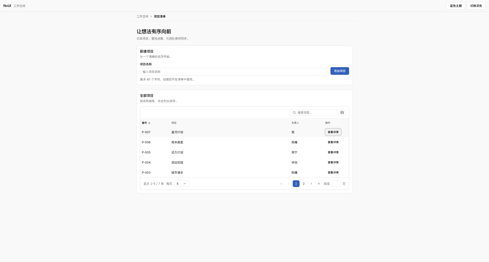
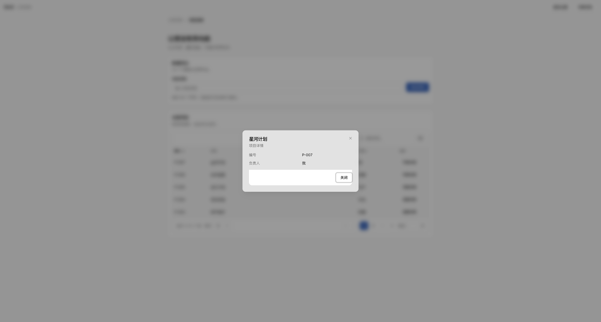
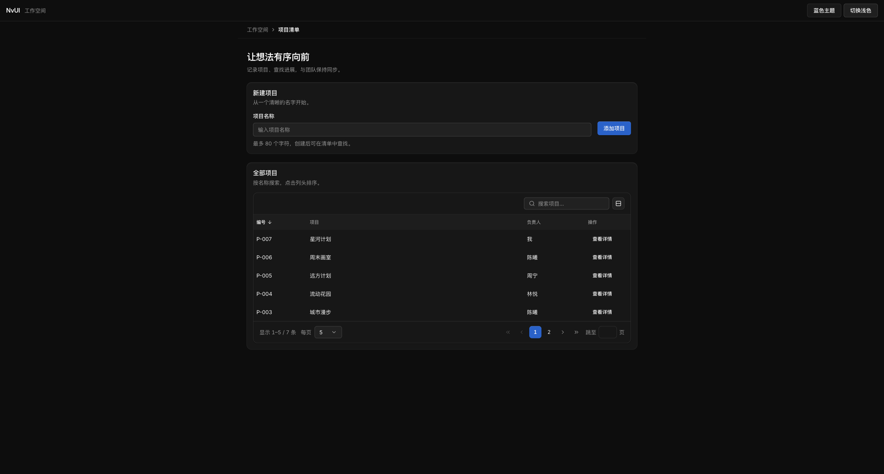

# T02 验证记录（2026-10-24）

基线/integration：`274d12baf1d5d27857beab0c7183d56623ffcefd`。任务分支 `feat/t02-desktop-standalone`；未合并 main/integration，未关闭 #3。全部下列结果为本轮 fresh，不继承旧库运行结论。

提交中的终端日志去除 ANSI 着色、行尾空格与多余末空行，保留命令、错误和结果；原始终端日志保存在 `/tmp/nerv-ui-t02`。

## RED → GREEN

- 原始 `pnpm -C frontend build` 在 UI 类型检查导入旧 FileStorage `appsettings.json` 时失败，见 `red-build.log`。改为宿主传入的 opaque purpose fixture，旧后端注册约束保存在原库消费方参考；31 项 FileUpload 行为继续执行。
- 新 workspace 出现后，旧成员解析触发 `ERR_PNPM_WORKSPACE_PKG_NOT_FOUND: @nerv-iip/api-client`，见 `red-host.log`。显式只纳入 UI/playground 后安装成功。
- `App.test.ts` 先因宿主缺失 `App.vue` 失败（`red-host-component.log`），最小实现后 `adds a named project from the form to the searchable table` 通过；真实 DOM 新增项目、搜索并清空表单。
- CSS 入口 guard 先拒绝公开样式（`red-css-guard.log`）；精确入口放行后通过。另有 `main.css` 不在扫描集的 RED（`red-css-scan.log`），纳入 CSS 后通过 `green-css-scan.log` 的 21/21。
- 曾用 `pnpm --filter ui test <file>` 意图缩小验证，但脚本自带 `src`，实际运行全 UI：582 通过、7 失败，另一个套件因旧后端导入未发现测试。原始结果保留在 `red-css-guard.log`，不作为最终通过数。
- `--offline` 安装尝试曾因本地缺 `@types/node@26.1.1` registry metadata 失败；随后正常 frozen 安装成功。初始宿主 `vite build` 因当前 Vite Plus 只提供 `vp` 失败，改用现有 `vp build`，未新增工具或升级依赖。

## 本地验证

| Requirement | Evidence |
| --- | --- |
| 无旧 checkout/SDK 的 workspace 安装 | 全新 `/tmp/nerv-ui-t02-clean.*` 源码副本，无 `.git`、`node_modules`、构建产物；`pnpm -C <clean>/frontend install --frozen-lockfile` exit 0，见 `clean-install.log` |
| UI 与宿主类型、宿主构建 | 干净副本 `pnpm -C <clean>/frontend build` exit 0；串行两份 `vue-tsc --noEmit` + Vite production build，见 `clean-build.log` |
| 库组件行为与库内契约 | `pnpm -C frontend test`：UI **38 文件 / 614 PASS / 0 SKIP / 0 FAIL**，含现有 input/table/dialog/file-upload 等；见 `tests-final.log` |
| 宿主表单到表格行为 | `adds a named project from the form to the searchable table`；同一命令 playground **2 文件 / 10 PASS / 0 SKIP / 0 FAIL**，包含 CSS/TS/Vue 稳定包边界扫描 |
| CSS 边界 | `allows the documented stylesheet entries and rejects private style paths`；`guards Vue, TypeScript and CSS sources and skips tests and declarations`，见 `green-css-scan.log` |
| 文档静态契约 | `pnpm -C frontend --filter @nerv-iip/ui test:docs`：**3 文件 / 6 PASS**；包含 VitePress isolation 的三个原断言，见 `docs-tests.log`。只证明源码契约 |
| 格式、lint | 变更文件 scoped `vp fmt --check`、`vp lint` exit 0，见 `fmt-check.log`、`lint-final.log`；未宣称全库 lint |
| 版本与冻结来源 | 对比 T01 lock 的 resolved package keys：新增 `[]`、裁剪不可达包 266；`git diff --exit-code` 核对 migration 和冻结原版区零改动（唯一 ui/ 变更为受治理 file-upload 测试） |

jsdom 输出 `Could not parse CSS stylesheet` 警告；实际 CSS 由下方浏览器验证。构建保留 VueUse 两条 `INVALID_ANNOTATION` 警告，退出码 0；无体积改进承诺。

## 真实浏览器

优先尝试 T3 preview；连续两次 snapshot 15000ms timeout 后回退 ego-browser，原错见 `preview-errors.txt`。使用自己的 TaskSpace 27/p1，实际视口 **2320×1245 CSS px**，验证 production preview `http://127.0.0.1:4173/`，结束后关闭自有 tab。

| Requirement | Evidence |
| --- | --- |
| 表格与布局 | 初始 5/6 条，下一页 1/6 条（P-006），返回并编号降序首行为 P-006；容器宽 1152px，桌面无横向溢出；`browser-table.json` |
| 表单/搜索 | 输入“星河计划”，Enter 提交，搜索返回唯一 P-007，表单为空；`browser-added.json` |
| dialog 键盘与关闭 | 打开后焦点在内部；Tab 在两个关闭控件内循环；Escape、footer Enter 关闭均还给“查看星河计划”原按钮，包含多行列表场景；`browser-focus.json`、`browser-theme-responses.json` |
| 明暗与强调色 | 浅色背景 `oklch(0.985 0 0)`，深色 `oklch(0.145 0 0)`，文字反向；蓝色实际 `--primary` 与按钮背景为 `oklch(0.55 0.18 255)`；刷新持久化；`browser-theme-responses.json` |
| 真实资源响应 | HTML/JS/CSS 均 HTTP 200，记录长度、content-type、SHA256；浏览器实际字体响应 200，Runtime/Network reload 捕获 71 个事件，exception/loadingFailed 0；`browser-runtime.json`。JSON 内另有浏览器扩展注入脚本，非宿主资源 |
| 与最终干净构建的对应关系 | 浏览器验证的 JS/CSS 与最终 clean build **SHA256 完全相等**。HTML 在 formatter 后仅发生格式化，初次 hash 比较为 false，如实保留；最后经 HTTP 重新获取 HTML，与 clean build 相等。见 `artifact-comparison.json`、`final-html-headers.txt` |

截图在颜色/过渡结束后保存并目视核对：

## UNRUN 与后续责任

CI、PR 审核/合并、发布、仓库外安装产物 #11、原库四应用接入 #12–#15、设备/全栈均 **UNRUN**。移动包、应用壳、排程、完整文档站未纳入本票活动 workspace；恢复分别属 #5/#9/#8/#10。触屏、大屏、上传预览真实浏览器全能力验收不在本票。

`frontend/reference-tests/nerv-iip-consumers.test.ts` 的旧应用/后端契约在本票 **UNRUN**；没有把迁移参考测试、T01 原样 provenance 或旧运行证据算进本轮通过数。后续 UI 修改不要求 T01 原样比对保持绿。
