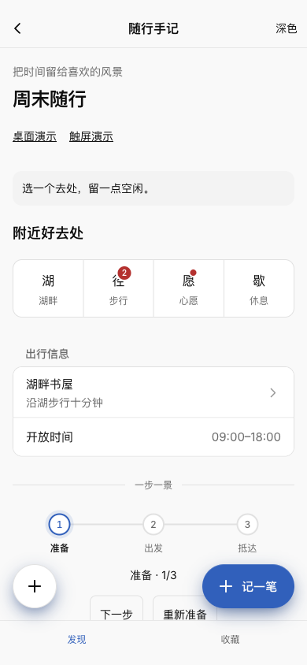
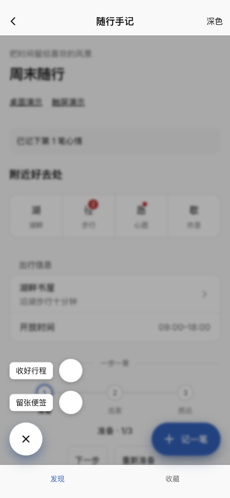
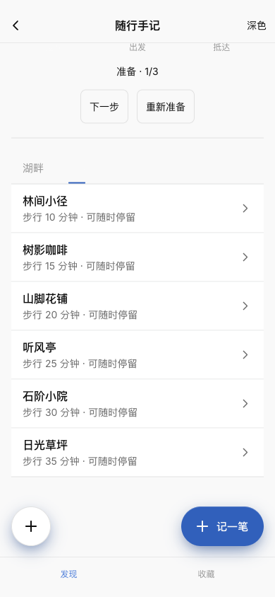
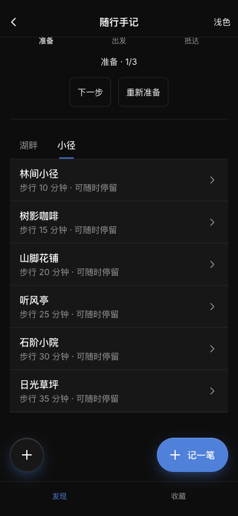
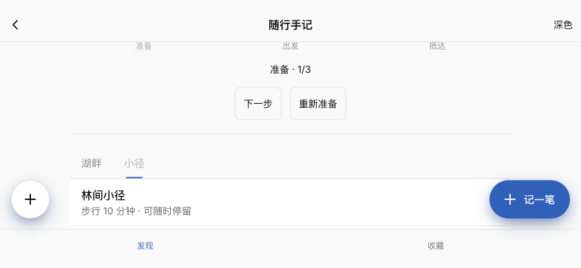
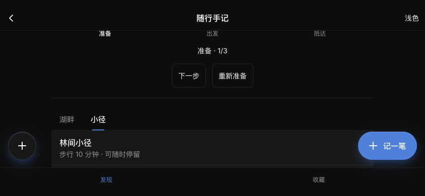

# T04/N01：移动页壳与导航验证

对象：[子票 #45](https://github.com/Mang-X/nerv-ui/issues/45)，只覆盖父 [#5](https://github.com/Mang-X/nerv-ui/issues/5) 五组中的 N01 / 11 件。实施分支 `feat/t04-n01-mobile-shell`；基线 HEAD / merge-base 均为 `49a4db7c8348fc7058db611a4defd5153d91eaa5`，tree `24ed9d0b428decb8f0ee21824f563cb3da64c8de`。开工工作树与 integration root 均 clean。2026-10-24 fetch 后 origin integration tip 仍为此 SHA；最终 PR head/tree 由交付回执给出，证据自身不嵌入循环引用的提交 SHA。

实际工作树 `/Users/mang/Project/nerv-ui-worktrees/t04-n01-mobile-shell`，所有安装、测试与 Git 命令均显式在新库执行。原 Nerv-IIP checkout 未写入、未启动。原始材料在 `/tmp/nerv-ui-t04-n01`；本目录保留关键日志、读回、失败与截图。归档文本日志仅去除终端 ANSI 与行尾空白，未改错误或结果；原始字节保留在上述 /tmp 目录。

## 接入与范围

恢复 `@nerv-iip/ui-mobile` 的 workspace 成员、来源 importer 和聚合类型检查。入口 `/#mobile`，桌面及 `/#touch` 保留。组件只从主桶消费；CSS 只从公共 `@nerv-iip/ui/styles.css` 和既有 `@nerv-iip/ui-mobile/styles/mobile.css` 消费。移动 CSS 增加包内 `@source '../'`，宿主无私有扫描路径/alias。根 TypeScript include 同步移动源码；包内 typecheck 由聚合命令串行运行。

“周末随行”使用固定内存数据：湖畔书屋等六个湖畔去处、林间小径等六个小径去处，刷新重置。没有网络业务数据、auth/router 模型或 API-client。11 件组件的宿主分工见 [移动接入说明](../../mobile-standalone.md)。FAB 仅为既有 `text` 属性补 `aria-label`，事件和图标外观保留，文档同步；原库回传仍待接入票评估。

## RED → GREEN

| 公共接缝            | 实际 RED                                                                                                                                 | GREEN                                                                                                      |
| ------------------- | ---------------------------------------------------------------------------------------------------------------------------------------- | ---------------------------------------------------------------------------------------------------------- |
| App 直达入口        | `opens the standalone mobile shell directly and preserves desktop and touch entries`：收到桌面标题，预期周末随行；[日志](red-entry.log)  | [3/3](green-entry.log)                                                                                     |
| 受控导航/标签/返回  | `keeps bottom navigation and content tabs controlled and returns with the public back event`：缺少 tablist；[日志](red-navigation.log)   | [1/1](green-navigation.log)                                                                                |
| 单元/列表/步骤/网格 | `selects cells and list rows, advances steps and receives grid item identity`：缺少状态回显；[日志](red-selection.log)                   | [2/2](green-selection.log)                                                                                 |
| FAB 与主题宿主      | `receives single and speed-dial FAB events and switches the shared theme`：缺少操作；[日志](red-fab-host.log)                            | [3/3](green-fab-host.log)                                                                                  |
| FAB 公共行为        | `names the speed-dial trigger with text and emits the selected action identity once`：速拨主按钮无可访问名称；[日志](red-fab-public.log) | [2/2](green-fab-public.log)，另有 `emits click for a single action and does not expose a speed-dial state` |
| CSS 精确白名单      | `allows only the public mobile stylesheet and rejects lookalikes and private mobile paths`：既有公共 CSS 被拒；[日志](red-hygiene.log)   | [22/22](green-hygiene.log)，同测私有、未知和近似路径继续拒绝                                               |

前两片的通过不是所有后续断言都曾 RED；既有行为从未伪造为新增 RED。测试使用真实公共组件与宿主，不 mock 库内实现。源码命名、文档与包图属于静态/工程接缝，不冒充浏览器行为。

## Fresh 门禁

Node >=22.18；task-local `/tmp/nerv-ui-t04-n01/bin/pnpm` 只执行 `corepack pnpm@11.22.0 "$@"`。全局 pnpm 未改，nested scripts 使用同一 PATH。重型命令串行执行。

| 分类                                | 命令（在 frontend，PATH 前置 shim）                                                   | fresh 结果                                                               |
| ----------------------------------- | ------------------------------------------------------------------------------------- | ------------------------------------------------------------------------ |
| clean frozen 安装                   | `pnpm install --frozen-lockfile`                                                      | exit 0，先移除本任务四个安装目录；[日志](clean-install.log)              |
| UI 行为/命名/token/层与 import 契约 | `pnpm --filter @nerv-iip/ui test`                                                     | 43 文件 / **644** 通过；[日志](ui-tests.log)                             |
| 移动行为                            | `pnpm --filter @nerv-iip/ui-mobile exec vp test run src/components`                   | 12 文件 / **73** 通过；[日志](mobile-behavior.log)                       |
| 移动命名/runtime 导出静态契约       | `pnpm --filter @nerv-iip/ui-mobile exec vp test run src/nvui-naming.contract.test.ts` | 1 文件 / **6** 通过；[日志](mobile-naming.log)                           |
| 移动静态 docs 契约                  | `pnpm --filter @nerv-iip/ui-mobile test:docs`                                         | 1 文件 / **2** 通过；[日志](mobile-docs.log)                             |
| UI 静态 docs 契约                   | `pnpm --filter @nerv-iip/ui test:docs`                                                | 3 文件 / **6** 通过；[日志](ui-docs.log)                                 |
| 宿主行为与 import 契约              | `pnpm --filter @nerv-iip/playground test`                                             | 4 文件 / **22** 通过；[日志](host-tests.log)                             |
| UI/mobile/host 类型 + 宿主构建      | `pnpm build`                                                                          | 三份 `vue-tsc` 与 Vite build exit 0；[格式化后最终构建](build-final.log) |
| 根 TS include                       | `pnpm exec vue-tsc --noEmit -p tsconfig.json`                                         | exit 0；[日志](root-typecheck.log)                                       |
| scoped fmt/lint                     | `vp fmt --check` / `vp lint`（变更范围）                                              | exit 0；[fmt](fmt-check.log)、[lint](lint.log)                           |

分类执行与时间见 [gates.json](gates.json)。根 test 仍会运行全部移动行为及命名，只将静态 docs 单独放入 `test:docs`；没有删除或改弱原组件断言。[source-retention.json](source-retention.json) 对基线逐文件校验：原移动包 71 个 tracked 文件中 68 个未改，变更只有 package scripts、mobile CSS 与 FAB；**11 个原行为套件均原样保留，主桶原样保留**。新增 FAB 套件 2 个用例。没有因 workspace 恢复而改写旧 app 扫描期望；旧消费者参考契约仍由 #12–#15 各接入票负责，完整文档站运行由 #10 负责。

jsdom `Could not parse CSS stylesheet` 在首个基线 RED 已存在；保留提示，没有屏蔽。构建有来源 `@vueuse/core` 的 Rolldown `INVALID_ANNOTATION` 提示，exit 0；未改依赖消除提示。浏览器运行异常见下一节。

## 依赖图与实际解析

[lock-audit.json](lock-audit.json) 对比全部对象值而非 keys：

- 相对固定基线，**973 packages + 973 snapshots** 的 resolution、dependency/optional 边、peer 上下文和所有字段语义完全相等；新增/删除/变更节点均 0，optional 分类变化 **0**。T02 的原五项 optional 分类保持不动。
- `packages/ui-mobile` importer 与 T01 integration `274d12baf1d5d27857beab0c7183d56623ffcefd` 中同项全对象相等；宿主只增加 `workspace:* → link:../../packages/ui-mobile`。其余 importers/settings/overrides 不变。
- clean frozen 安装实际成功；UI/mobile/playground 的 `vue` realpath 相同（3.5.39）。mobile 实际解析到 @lucide/vue 1.24.0、@vueuse/core 14.3.0、reka-ui 2.10.1 及本库 UI 主桶，无新三方依赖、无升级。
- T02 F1 与 T01 来源记录完全未改。本轮不以安装成功替代锁图语义核验，也不以 keys-only 推断无升级。

## Fresh 浏览器

服务为 `pnpm --filter @nerv-iip/playground preview --port 4317 --strictPort`，访问 `http://127.0.0.1:4317/#mobile`。自有 ego-browser TaskSpace `30` / `p1`，Chromium 154，桌面 UA + 390×844 / 844×390 CSS 视口；**没有模拟器或物理设备声明**。

T3 自有 tab 先行尝试，连续两次 snapshot 返回原错 `Preview snapshot failed: Preview automation snapshot timed out after 15000ms.` 后按约定切换。首次 URL/resize 参数修正、服务启动时的 chrome-error 和两次超时均见 [原始错误](preview-errors.txt)。

| 实测                         | 读回                                                                                                                                                                                                                                                                                                                                                                                          |
| ---------------------------- | --------------------------------------------------------------------------------------------------------------------------------------------------------------------------------------------------------------------------------------------------------------------------------------------------------------------------------------------------------------------------------------------- |
| 390×844 页壳/安全区/CSS 闭合 | header 61px（padding-top 12px）；footer 57px（padding-bottom 8px）；main 726px、overflow-y:auto、scrollHeight 1355px。五个已编译 utility 的 CSSOM 包含原 `env(safe-area-inset-*)` 表达式，viewport-fit=cover；[CSSOM](browser-utilities.json)。底栏 min-height 48px，列表 min-height 56px；root/body/main scrollWidth 均 390。FAB 56px 高、hit-test 为自身按钮。[几何](browser-portrait.json) |
| 导航与事件                   | 网格 key/index、cell、步骤上界禁用/重置、标签替换后的新列表身份、收藏回看、back 保持标签、单动作 FAB、速拨展开通过。[9 项读回](browser-interactions.json)                                                                                                                                                                                                                                     |
| FAB select 与入口保留        | `随行操作：收好行程 · save · 1`，expanded=false；桌面→触屏→移动分别读回正确 hash 与标题。[读回](browser-routes-resources.json)                                                                                                                                                                                                                                                                |
| 真实滚轮滚动/FAB 固定        | main 到末尾 scrollTop 628.5；window scrollY=0，header y=0、footer y=787、FAB y=716 均不变；末行 bottom=675，在 footer 上方。[读回](browser-scroll.json)                                                                                                                                                                                                                                       |
| 390×844 深色                 | dark=true，无横溢出；[读回](browser-theme.json)                                                                                                                                                                                                                                                                                                                                               |
| 844×390 横屏深浅色及点击     | header/main/footer 连续，footer bottom=390；FAB hit=true；root/body/main 宽均 844。底栏/返回/FAB 点击和深浅切换通过。[读回](browser-landscape.json)                                                                                                                                                                                                                                           |
| 资源与数据身份               | 实际 JS/CSS/Inter 字体请求均 200；fonts=loaded；无业务 API/CDN 请求；reload 捕获 runtime error/unhandled rejection 为 0。六行中性数据与宿主源码一致。[读回](browser-routes-resources.json)                                                                                                                                                                                                    |

实际资源 SHA256 与本地 dist 对照相等：[artifacts.json](artifacts.json)。JS `index-COjIw8zt.js` / `4edb6187840b7f7014ddba2f4964aedc537ea7a3a11d26efe0a27a4f4ff35cab`；CSS `index-sZgCj8PD.css` / `a3c6c33a1a6075265c4790dacb2cdb92a72f6f496d8bbe4274c2ca2dc39528cc`。

保留自动化失败：ego 跨 round 的 CDP viewport override 会恢复默认，首次几何检查读到 2320×1245；随后每轮显式设置。首次 wheel 检查只等 scrollTop>200，过早要求末行进入视口；改等实际滚动边界后通过。该失败中断主题步骤，首次横屏沿用错误主题假设也失败；改为显式读/设主题后通过。[首次滚动失败](browser-scroll-theme.log)、[首次横屏失败](browser-landscape.log)、[最终滚动](browser-scroll-theme-final.log)、[最终横屏](browser-landscape-final.log)。没有据这些工具/检查失误修改产品或掩掉原错。

## 继承与 UNRUN

继承的是 T01 原始候选源码、既有公开名、token/CSS 层约定与 T02/T03 历史事实；本票执行的上述门禁和浏览器为 fresh。T02 锁图 F1、T03 keyed 焦点 F1 的历史失败未改写；本轮 UI 套件包含已集成的 T03 回归，但没有重跑完整 T03 浏览器验收。

UNRUN：CI、产物 #11 的仓库外安装、完整文档站启动/构建、物理设备/非零硬件安全区、软键盘/扫码枪、原 Nerv-IIP 接入/全栈、#43。其余 37 件完整独立示例由 #46/#47/#48/#49 接续；T08 更高组合仍各票负责。本票不合并、不关闭 #45 或父 #5，不把静态 48 件资料覆盖计作 48 件动态验收。
