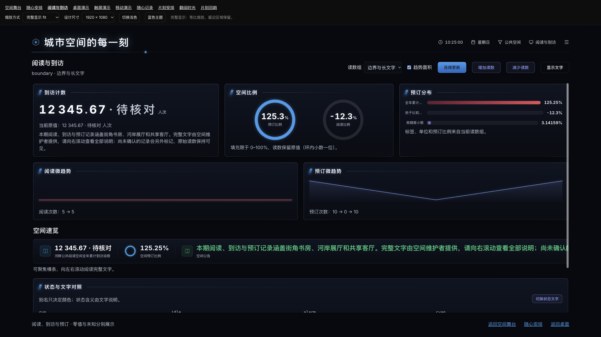
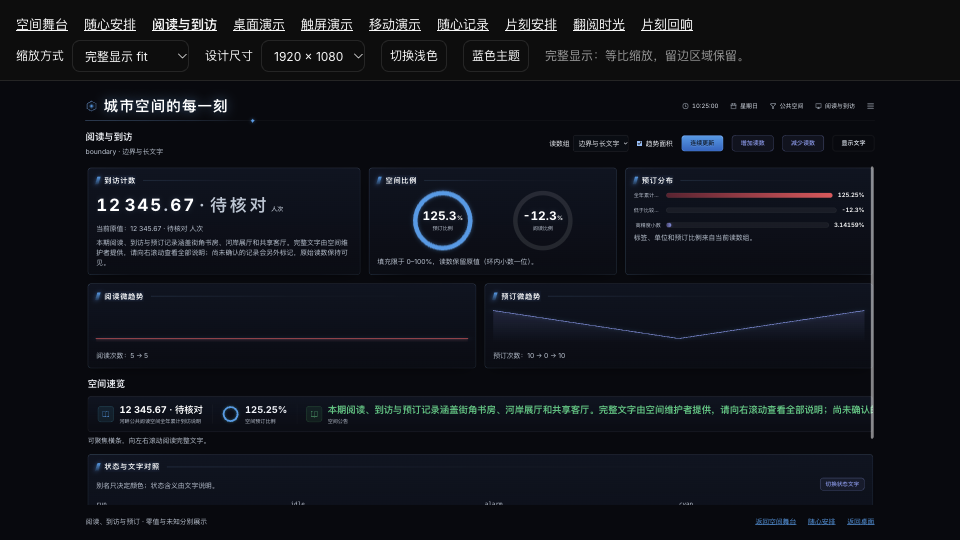
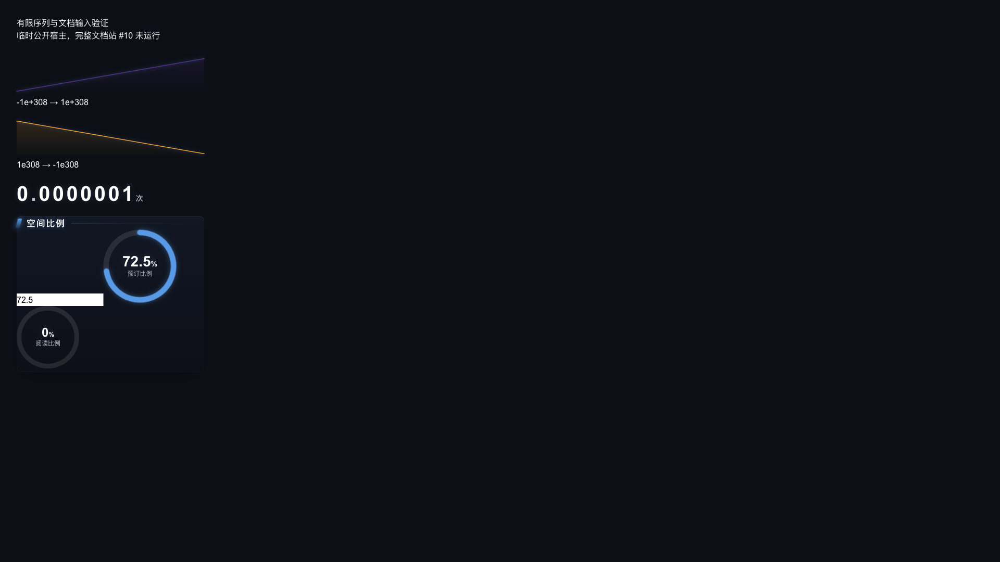

# T05/A03 F3：有限极值微趋势与临时 harness 身份桥接

仅修 #60 / PR67 的 R2 F3；O2 最窄改为“空间公告”。不合并、不关闭 tracker，交由新独立 R3。临时文档 harness 身份差异是证据解释，不另计产品 finding。

## 固定对象与范围

- integration base：`9f53a679b2854a34d661a17c70ac530cc57a4826` / tree `b1fd21648cd03a424977c0a46be6a1ee5623f603`。交付前 fetch/merge：Already up to date。
- R2 受拒 head：`3d713dbb8bc053958fcf75a66d48c89c28f48c3d` / tree `c1fe96edfdeb181622ecbca6d906770480b13d15`。
- 本轮实际验证代码提交：`0a0c5833c982e0aae401c888a4f78c577876f5ab` / tree `50f2416b9e6bd1e7e69b523a9e8db6236aab4a7b` / frontend tree `99126f4cfc7927a4b7208a8014e8efe7fdedb99d`。后续仓内提交只归档本文与截图；最终 head/tree 回读在 handoff。
- 全部 shell 显式 workdir：`/Users/mang/Project/nerv-ui-worktrees/t05-a03-screen-indicators`；branch `feat/t05-a03-screen-indicators`。root、旧源与双 main 均只读；不写自动 Nerv-IIP 树。

F3 / P2 是继承缺陷：`[-1e308, 1e308]` 均为有限 number，旧实现 `max - min` 溢出，line 为 `M0.0 50.0 L240.0 NaN`，area 同样失效。R2 的 base/head 首屏及 setProps 共 **4 条产品 FAIL**、普通 `[-10,10]` 对照 **2 PASS** 原样继承；未重跑为 fresh，原 probe exit0 仅表示反例成立。

最窄修复只在跨度非有限时将端点及当前值各除以 2 再算相对比例；普通路径仍走原公式。保留常量底部水平线、少于两点虚线、负值、area/color、useId。未收紧有限序列合同；NaN/Infinity 仍不属于有效输入，也未引入任意精度承诺、框架或依赖。相对 R2 只改 Sparkline、同文件正式回归、API 页说明及 O2 宿主文案；R1 F1/F2 实现逐字节不变。

## Requirement | Evidence

| Requirement                                 | Evidence                                                                                                                                                                                                                                                                                                                                 |
| ------------------------------------------- | ---------------------------------------------------------------------------------------------------------------------------------------------------------------------------------------------------------------------------------------------------------------------------------------------------------------------------------------- |
| 首屏及更新时有限、上升/下降/相对高低真实    | 正式 `sparkline preserves finite rising falling and relative geometry across overflow range updates`：RED 1 FAIL → GREEN 1 PASS；完整文件最终 31 PASS。公开 mount/setProps，断言 line 和 area 的 SVG attribute/CSS d 为固定几何字面量，无 private vm。上升 `M0.0 50.0 L240.0 6.0`；下降反向；五点 y 为 `50,39,28,17,6`，非仅检查无 NaN。 |
| 常量极大/极小、同号相邻有限与正负极小排序   | `sparkline retains constant extremes adjacent finite values and subnormal ordering`：正负 MAX 常量与 MIN 常量均底部水平；正负同号相邻有限值均保留端点方向；`[-MIN_VALUE,0,MIN_VALUE]` 为 `50,28,6`。                                                                                                                                     |
| 普通、空/单点、负数、颜色、面积、双实例兼容 | 既有 `sparkline renders explicit empty and single data as a dash then constant and changing point identities`、`sparkline keeps each area reference local even when the random source repeats` fresh PASS；完整 UI 与真实 browser 同时覆盖。                                                                                             |
| 新产物真实 finite SVG                       | browser-02：18 组 normal/reduced 观察，首屏、普通→极值、area off、五点、常量、次正规数、空/单点、卸载重挂；双实例本地 gradient/color。记录 `getTotalLength` 和实际渲染起终点，升线端点 `(0,50)→(240,6)`、降线反向，CSS d 有效。`raw/browser/finite-geometry.json`。                                                                      |
| R1 F1 不回退                                | 正式 `ring documentation input clears to unknown and recovers finite zero decimal negative and overflow readings` fresh PASS；本轮 browser-02 从实际 Markdown 编译的临时宿主验证 input 清空→未知，0/12.25/-12.3/125.25 恢复，保留另一真实 0；`document-input.json` 五例。临时宿主不是完整 docs #10。                                     |
| R1 F2 不回退                                | Digital 源码相对 R2 完全一致；完整 UI 中科学计数、精度边界、加权端点、快变/reduced 等原正式回归 fresh PASS。R2 独立 43 观察、原 direct 3 PASS、新 head4 PASS/base4 FAIL **仅继承原对象**，不重算为未解决，也不声称本轮重新执行 43 条。                                                                                                   |
| 正式宿主数据、motion、theme、route cleanup  | browser-04 五组 source/双 SVG；05 四外壳 theme、真实 normal/reduced、快速更新/字符串/连续更新；06 九 route 本组 RAF/interval/MediaQueryList 清理均 0、重挂及深链刷新；07 实测 1920×1080/960×540 × light/dark，原值列不截断、纵滚七状态；相关脚本、JSON、日志在 raw/browser。                                                             |
| 临时 harness 身份闭合                       | `harness-diagnosis.mjs` 三次受控 build 与 `raw/harness-root-cause.json`；下节给出 root/scoped ID 与 outDir/旧产物扫描两条完整因果链。原两 FAIL 不改写。                                                                                                                                                                                  |

两个新增测试不逐行镜像比例公式：期望是独立的端点/中点/四分位及原兼容几何。RED 使用修复前真实 SFC；初次误用 frontend 根测试配置的导入分析失败没有运行断言，单列 `red-command-config-fail.*`，随后在包配置取得有效 RED。过滤运行的 pending29 是有意未选中；最终完整文件与全量门禁 pending0。

## Fresh 门禁

Corepack + 原 task-local PATH shim，pnpm **11.22.0**、Node **24.18.0**；无 install、无 Python、无新依赖，仅本席串行重型门禁。

- `node .../handoff/gates.mjs`：UI **48 文件/705**、mobile **27/144**、host **12/101**、静态 docs **6+2**；每项 exit0、JSON success=true / failed0 / pending0，逐日志无 Unhandled Error/Rejection/uncaughtException。
- `pnpm -C frontend build` exit0：三个活动包 vue-tsc 与正式 production build。PURE / INVALID_ANNOTATION / chunk 警告保留在 build.log，未清洗。
- `maintenance.mjs`：本票 **19 文本 fmt / 10 源码 lint / scoped diff-check** exit0；本页随后单独 fmt/diff-check。未改冻结区。
- `audit.mjs`：16 依赖输入完整字节等于 base；三活动包 Vue 3.5.39 同 realpath/模块对象；主桶/CSS/冻结/A01/A02不变，除 Sparkline 外六指标实现逐字节等于 R2。

## 两次旧 harness 身份 FAIL 的根因

R2 的 `harness-identity-first-fail.json`、`harness-identity-second-fail.json` 和两个 build 脚本/日志均完整保留于 `raw/inherited-r2/`。它们仍然是 **身份 FAIL**，本轮不把旧响应改写成等于新 dist，也不授予旧临时宿主同产物继承。

**第一次：真实 source root 不同导致 Vue production scope ID 不同。** 原 root 为 `/private/tmp/nerv-ui-t05-a03-fix/handoff/harness`，R2 首次 root 为 `/private/tmp/nerv-ui-t05-a03-merger-r2-20261025/harness`。三个入口源文件 index.html/main.js/RingExample.vue 的完整字节一致；同依赖、同产品 SFC。已安装 @vitejs/plugin-vue 6.0.8 的生产 ID 是 SHA256(`relative(root, filename) + source`) 前 8 位：ScreenPanel `937c5379→e27f9aa8`，RingGauge `34e1c3af→93c374da`，DigitalFlop `c80329d8→e6b970a2`。按真实相对路径重算全部吻合；两份归档 JS/CSS **仅规范化这些 scoped ID 后完整字节相等**，HTML 的内容散列引用随之改变。

**第二次：root 匹配但改 outDir，让原 root/dist 进入 Tailwind 自动源扫描。** 归档第二次 JS 已与旧 JS **原字节完全相等**；CSS 多出工具类。三次受控重建使用相同真实 root、三个 fixture 字节、依赖、5213 个模块 ID：A 输出 root/dist；B 保留 A 的 root/dist 并输出外部目录；C 将 A 的旧 dist 移出 root 后仍输出另一外部目录。A/B/C JS 相同，A/C CSS 相同，B 新增 CSS 规则与旧第二次 FAIL 的新增规则清单**逐项完全相同**。Tailwind 4.3.2 默认扫描 build root，原 standalone.css 另有 package @source；改输出目录使旧 bundle 不再落在当前 outDir 排除边界。是临时构建输入/输出布局差异，没有产品 props 变化。

`harness-controlled-runs.json` 留存真实 root/outDir、模块 ID、每次资产 hash、开始/结束时间；`harness-root-cause.json` 留存 fixture/source hash、scope 计算、完整规则 delta、依赖版本。不同时间的 A/C 字节相同，排除本次差异为时间戳注入；16 依赖输入和 Vue 身份另有完整字节证据，无重装。诊断脚本首轮语法错误、metadata 的 package exports / Vue 解析错误均独立保留，修正后诊断 exit0，未当作产品失败。

以上解释字节差异；本轮真实行为证据使用**新独立 harness**，各响应对其自身新 dist，不要求临时宿主重现旧 chunk 字节，也不顺修完整 docs #10 基建。

## 新产物与浏览器身份

正式生产源：任务树 `frontend/apps/playground/dist`；临时源：`handoff/harness`（实际 Markdown RingExample + 公开 NvSparkline/NvDigitalFlop）；各自独立 dist。

| 对象         | 新 JS               | 实际 HTTP200 字节 / SHA256                                                  |
| ------------ | ------------------- | --------------------------------------------------------------------------- |
| 正式宿主     | `index-Ecb0Os2i.js` | 562877 / `c4477b99461657cd3cd6de645640c05f638a069822df6e8ee8c254f82be9cb95` |
| 临时 harness | `index-CX6dFlv8.js` | 214484 / `248b91a944f6952aac1d808c51cc363296236a4304292dbbbaf5aa44f480c71e` |

浏览器 `page.fetch(..., {saveAs})` 保存 HTML/JS/CSS/Inter 字体的真实响应，每份与对应 dist 直接 `Buffer.equals`；正式4份、harness4份全部一致。完整 hash/bytes/status 在 `raw/browser/resources/final-responses.json` 与 `harness-resources/responses.json`；无旧 JS 冒充新 bundle。正式运行前后相关数据身份与响应相互对应。

T3 status/open/navigate 成功；snapshot 同一步两次原文 `Preview automation snapshot timed out after 15000ms.` 后按规则 fallback ego。初次 about:blank URL parse 错误也保留。ego 同一 space13 八轮均 exit0，最后 finish keep[]；自有 T3 tab 关闭，自有 4194 服务停止，无监控。

实际查看下列正式 1920/960 深色与 harness 1920/960 图。正式四组合均 JSON 实测 viewport；图片像素尺寸也单独核验。初轮 `harness-extremes-normal.png` 实际 2288×1213，**不作为1920证据**；补取 `harness-fixed-1920.png` / `harness-fixed-960.png`，分别精确 1920×1080 / 960×540。临时页 960 的文档环在纵向页面下方，不用它声明完整 docs 可读性。

## 继承、历史 FAIL 与 UNRUN

[R1修复与历史边界](../f1-f2/README.md)、[原实施](../README.md) 保持原对象。R1 拒绝 head `84d57b43798dceb4bc02a21231d885bf729e1926` 的 F1 新增/F2 继承已由 R2 确认修复；O1 已修。R2 material1 是本次 F3，optional O2 已改“空间公告”。实施自验不替代独立 R3。

保留原 round09 整轮 FAIL / round12 clean、R1 material9 FAIL、R2 base4 FAIL、F3 原 base/head4 FAIL、新 head4/base4 Digital比较、独立43观察、原direct3、raw diffcheck2/冻结fmt1/CSS/PURE及全部 harness 失败。新 GREEN 不覆盖历史 FAIL。本轮 metadata 未导出的 package.json / workspace 根不直接解析 vue 两次诊断错误也保留；均未改依赖。

UNRUN：CI（最新检查列表仍空、未取得）、packed/versioned #11、完整 docs #10、设备/模拟器、旧库接入/发布、父 #6 最终组合、native125% zoom。旧1366/精确半缩放/KPI键盘横滚只保留旧对象历史，本轮不重发 fresh。

完整 raw/脚本：`/tmp/nerv-ui-t05-a03-f3/handoff`；durable：`/Users/mang/nerv-delivery-evidence/nerv-ui/2026-10-25/t05-a03-f3/handoff`，过滤 node_modules/cleancheckout/cache/.vite，SHA256SUMS 单列。旧 t05-a03、t05-a03-fix、review-r1、review-r2 原档保持。任务树保留 clean 供独立 R3；#60/#6/#1 不关闭、#18不改、#61–64/T08/#43/#51不动。
