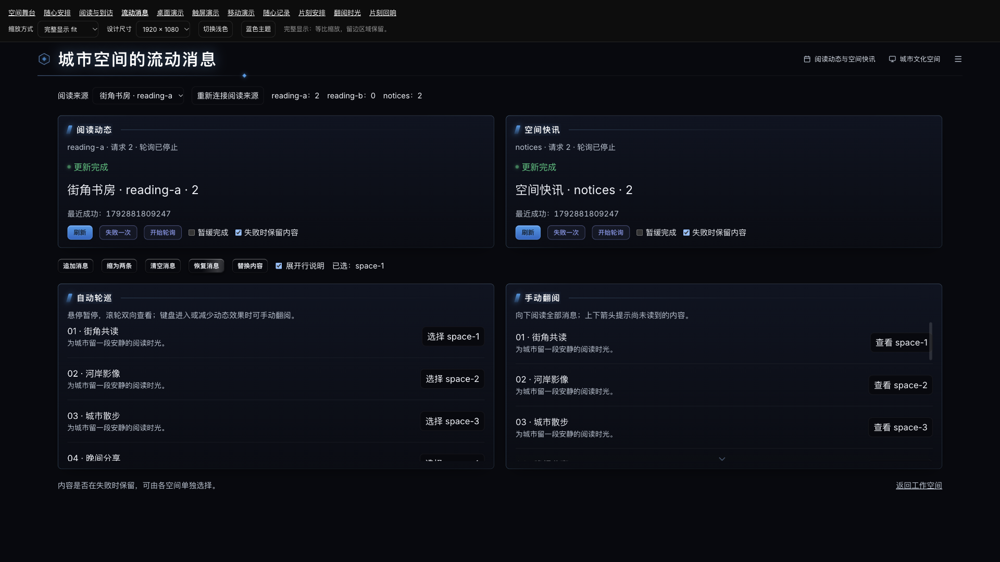
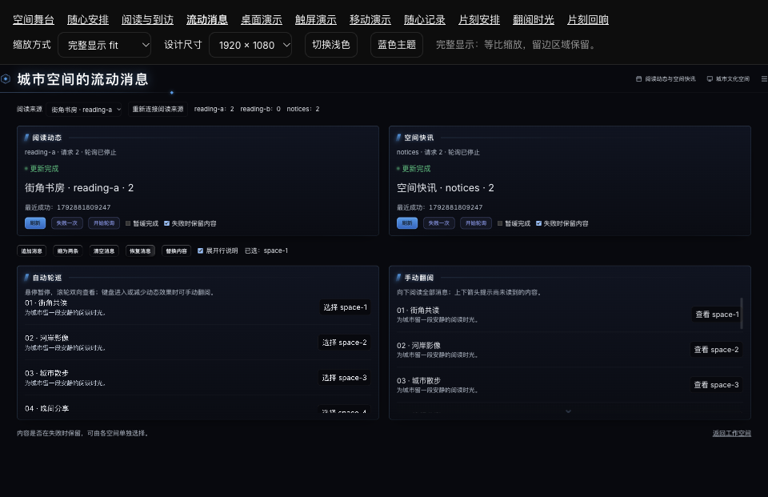
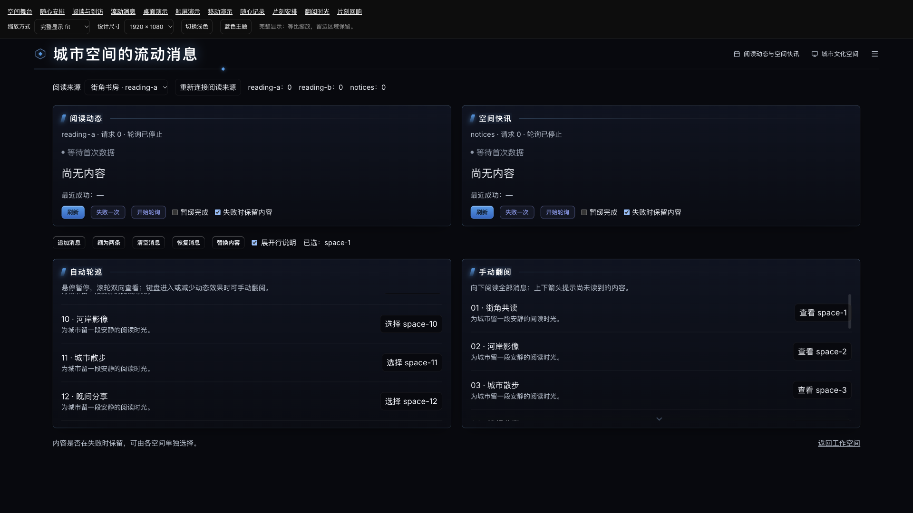
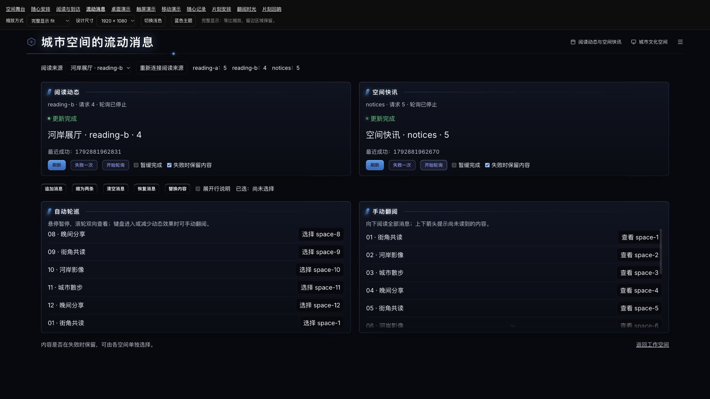

# T05/A04：数据新鲜度与两种滚动

对应 [#61](https://github.com/Mang-X/nerv-ui/issues/61)，父 [#6](https://github.com/Mang-X/nerv-ui/issues/6)，已批准 spec [#1](https://github.com/Mang-X/nerv-ui/issues/1)。基线 `ba1f99cff8e44cffa55f70341dc65935801ed2a2`，tree `f76c709bb200337d873775ce1103e702b7e84d1a`。工作树 `/Users/mang/Project/nerv-ui-worktrees/t05-a04-screen-data`，分支 `feat/t05-a04-screen-data`。最终 head/tree、integration 同步、push 与 PR 状态在 PR 和外部 `handoff/receipt.json` 固定，本文不自引用自己的 commit。

交付 `/#screen/data` 中性内存宿主、三件现有组件与 helper 的公共行为证据、四页 API 文档。生产库只修 `ScrollBoard.vue` 和 `ScreenScrollArea.vue`；`useScreenData`、两公开类型、`ScreenFreshness`、原 2 个 freshness 测试、全部导出和 token/CSS owner 与基线字节相同。原 helper 6 条断言保留，新增边沿用例；原来已 PASS 的合同不伪称 RED。

宿主阅读来源 reading-a／reading-b 通过 key 重建实例，setup 捕获固定 fetcher，notices 单独起实例。延迟请求只由公开“暂缓完成／完成”控件释放；结果和失败在发起时固定。宿主明确选择保留或撤下旧内容。没有真实 API、SDK、缓存、请求框架或取消新合同。stop/dispose 仍不 abort，也不冻结在途晚回。

## Requirement | Evidence

下列公开测试路径：U=`frontend/packages/ui/src/components/screen/`，P=`frontend/apps/playground/src/`。全部通过 effectScope、公开 props/slots、DOM、事件或系统边界操作，没有私有 vm。fake timers／可控 RAF／几何和 observer 桩仅证明逻辑；真实布局另列 browser。

| Requirement                                | Evidence                                                                                                                                                                                                                                                                                                          |
| ------------------------------------------ | ----------------------------------------------------------------------------------------------------------------------------------------------------------------------------------------------------------------------------------------------------------------------------------------------------------------- |
| 原 6 helper 与 2 freshness 合同            | U/`useScreenData.test.ts` 原 6 条保留并 fresh 通过；U/`ScreenFreshness.test.ts` 的 `exposes the freshness state with text instead of color alone`、`supports the waiting state without claiming live data` 原文件字节不变，fresh PASS。                                                                           |
| 首次失败与恢复不伪造成功                   | U/`useScreenData.test.ts` → `first failure has no invented data or success time and recovery clears error and stale`；原实现 PASS，无生产改动。                                                                                                                                                                   |
| 成功后失败保留，恢复清除 stale/error       | `failed refresh preserves data and last success time then recovery advances it`：包含真实零、保留时间与恢复时间。原实现 PASS。                                                                                                                                                                                    |
| initialData 不是成功                       | `initialData zero is retained on failure without pretending to have succeeded`：0、无成功时间、失败 stale。原实现 PASS。                                                                                                                                                                                          |
| 在途无重入与默认 15 秒                     | `manual refresh and polling do not reenter a pending fetcher and the default tick is fifteen seconds`：deferred + 手动重复 + 14999/15000ms 边界。原实现 PASS。                                                                                                                                                    |
| hidden、restart 与监听/tick 清理           | `hidden ticks skip requests and visible resumes once while stop restart and dispose clean listeners`：合成 hidden/event，stop 后不可补取，restart 无重复监听，dispose 后 timer0。原实现 PASS。                                                                                                                    |
| stop/dispose 晚回旧合同                    | `stop does not abort or freeze an in flight result and does not reschedule it`、`dispose does not abort or freeze an in flight result and does not reschedule it`：晚回仍写入旧实例，无新 tick。原实现 PASS。                                                                                                     |
| 低动效 JS 静止且内容可达                   | U/`ScrollBoard.test.ts` → `reduced motion stops JS translation and leaves the original list manually reachable`：RED `translateY(-100px)` → GREEN 0px，原始三动作保留；raw/`board-red-motion.json`、`board-green-motion.json`。                                                                                   |
| 重复副本不参与交互焦点                     | `duplicate rows are inert while original slot actions remain usable and focus pauses motion`：RED 副本缺 inert → GREEN，原始按钮保持启用、焦点静态模式。raw/`board-red-focus.json`、`board-green-focus.json`。                                                                                                    |
| 动态列表无越界白洞，短空静止               | `normalizes appended and shrunken content while hovered and keeps short empty and restored lists still or looping`：RED 悬停缩短仍 -500px → GREEN -200px；追加、两条、empty、恢复与副本数量均断言。raw/`board-red-resize.json`、`board-green-resize.json`。                                                       |
| hover/leave、双向 wheel 与卸载             | `hover pauses and leaving resumes with bidirectional wheel wrap and disposes RAF and media listeners`：正常移动、暂停、正负取模、运行中 reduced 切换与 RAF/media 清理。补充用例原对应行为 PASS；媒体桩误传事件的历史 FAIL 保留于 raw/`public-final.json`。                                                        |
| 反向 Tab 进入尾行仍可见                    | `entering focus on an original tail row reveals that action after switching to manual mode`：真实 browser 先发现 scrollTop0 的不可见尾行；公开系统滚动接缝 RED 0→GREEN400。raw/`board-red-reverse-focus.json`、`board-green-reverse-focus.json`，真实浏览器复验 scrollTop742 且尾行可见。                         |
| 手动 viewport/内容替换、resize、提示、清理 | U/`ScreenScrollArea.test.ts` → `tracks replaced viewport content and subsequent resize and scroll hints then disconnects on unmount`：RED 内容变化后 down 不更新 → GREEN；实际 Reka viewport，替换系统内容层后旧节点取消观察、新节点观察，scroll/resize/up/down/unmount。raw/`area-red.json`、`area-green.json`。 |
| 来源 A→B 倒序完成与独立状态                | P/`screen/ScreenDataDemo.test.ts` → `keyed source switch cannot display late A in B and independent sources keep their own request and freshness state`：缺宿主 RED → GREEN，A pending 时手动不重复，B先成功、A后完成不进入B，另一来源首次失败与恢复独立。raw/`host-red.json`、`host-route-final.json`。          |
| 宿主保留/撤下是显式选择                    | `host explicitly retains or withdraws failed content and recovery restores it while polling stops and restarts`：保留数据/时间、撤下、恢复、独立两轮与重新启动。                                                                                                                                                  |
| 宿主列表公开操作                           | `public list controls append shrink clear restore replace and change row height without losing original actions`：16→2→0→12、替换真实 DOM、行说明和原始动作选择。初次正文断言包含 Reka style 的 harness FAIL 保留。                                                                                               |
| 宿主延迟队列不丢失旧实例请求               | P/`screen/data-fixtures.test.ts` → `held requests retain captured source and outcome and all complete after a host remount`：新 fixture 最初只能完成最后一条，RED timeout → GREEN 全部释放且身份/结果固定；raw/`fixture-red.json`、`host-route-final.json`。                                                      |
| 深链、原入口与离页重新挂载                 | P/`ScreenDemo.test.ts` → `opens data deep link and disposes its polling before old surfaces then returns with fresh source state`：未路由 RED“城市文化空间”→GREEN 数据页面、两轮、返回 stage timer0、重入初始等待并保留 controls/indicators/stage。raw/`route-red.json`、`host-route-final.json`。                |

## Fresh 门禁与命令

所有 shell 命令显式 workdir 为上述目标 worktree；没有写自动 Nerv-IIP 工作树、原源库或双 main。node_modules 初始缺失，成功 frozen install 一次；task-local pnpm shim 通过 `corepack pnpm@11.22.0` 固定嵌套 PATH，不改全局 pnpm。Python 仅 `uv run --python 3.12 -- python`。

```sh
PATH=/tmp/nerv-ui-t05-a04/bin:$PATH pnpm -C frontend install --frozen-lockfile
PATH=/tmp/nerv-ui-t05-a04/bin:$PATH pnpm -C frontend --filter @nerv-iip/ui test --reporter=json --outputFile=/tmp/nerv-ui-t05-a04/handoff/raw/ui-final.json
PATH=/tmp/nerv-ui-t05-a04/bin:$PATH pnpm -C frontend --filter @nerv-iip/ui-mobile test --reporter=json --outputFile=/tmp/nerv-ui-t05-a04/handoff/raw/mobile-final.json
PATH=/tmp/nerv-ui-t05-a04/bin:$PATH pnpm -C frontend --filter @nerv-iip/playground test --reporter=json --outputFile=/tmp/nerv-ui-t05-a04/handoff/raw/host-final.json
PATH=/tmp/nerv-ui-t05-a04/bin:$PATH pnpm -C frontend --filter @nerv-iip/ui test:docs --reporter=json --outputFile=/tmp/nerv-ui-t05-a04/handoff/raw/docs-ui-final.json
PATH=/tmp/nerv-ui-t05-a04/bin:$PATH pnpm -C frontend --filter @nerv-iip/ui-mobile test:docs --reporter=json --outputFile=/tmp/nerv-ui-t05-a04/handoff/raw/docs-mobile-final.json
PATH=/tmp/nerv-ui-t05-a04/bin:$PATH pnpm -C frontend build
node /tmp/nerv-ui-t05-a04/handoff/audit.mjs
node /tmp/nerv-ui-t05-a04/handoff/maintenance.mjs
```

最终 UI **718**、mobile **144**、host **109**、静态 docs **6+2**，各 lane exit0；JSON success=true、failed=0、pending=0、无失败 suite；runner 未输出独立 numUnhandledErrors 字段，日志无 Unhandled Errors/Unhandled Rejection，不把字段缺席伪称字段值0。原交接 host101 是继承数字；本轮按实际109报告，不补造基线 fresh 跑数。三个活动包 vue-tsc 与生产 build exit0；维护 fmt19文本/lint12源码/scoped diffcheck 均exit0；lint保留原helper第86行 unused api 警告1条（原6测试字节保留），不称零警告。精确文件列表见 `raw/maintenance-files.json`，不扩大到冻结素材或旧 raw。

`raw/dependencies-final.json` 记录 16 份完整依赖输入 SHA256 与 base 字节比较、三消费者 Vue 的同一实际 realpath，全部不升级。全部 exports、helper/types、Freshness、tokens 逐字节比对。原 helper6与 freshness2 本轮 fresh 跑过；“字节相同”用于说明兼容，不代替 fresh 运行。

历史 FAIL 全保留：公开 RED；新增尾行键盘 FAIL；两个初始类型构建失败；媒体事件桩/空态 style 文本/审计错误路径/JSON one-liner 语法/formatter 路径与 browser harness 失误。详情 `raw/harness-errors.md`、对应原日志和 JSON。继承的旧 raw 全量 diffcheck exit2、冻结 fmt exit1、jsdom CSS parse、VueUse PURE/INVALID_ANNOTATION、chunk 警告仍保留；本票 scoped PASS 不覆盖它们，也不修 A01/A02 的旧 P3。

## Fresh browser 与最终 dist

T3 preview 先 status/open；snapshot 同一步两次原文均为 `Preview snapshot failed: Preview automation snapshot timed out after 15000ms.`，resize 曾设置1920但实际1280。按规则切 ego-browser，唯一 TaskSpace14/p1。所有脚本与原始结果保留；只有列出的 clean 轮次记 PASS，不把历史失败轮次整体称为通过。

| 实际对象                             | Evidence                                                                                                                                                                                                                                                                                                                           |
| ------------------------------------ | ---------------------------------------------------------------------------------------------------------------------------------------------------------------------------------------------------------------------------------------------------------------------------------------------------------------------------------- |
| 数据完整闭环、独立请求计数与晚回     | 格式化前构建上 browser-19 exit0（最终对象按下述 scope-ID 等价证据继承），`browser/data-lifecycle-final.json`：首次失败无内容/成功时间；成功后失败保留；公开 checkbox 撤下与恢复；A请求5 pending、B请求1成功、释放A不改变B；两个实际 tick分别 `[2,1]`、`[3,2]`；B停止而 notices 到4；B重启到4。无任意 sleep 冒充长期运行。          |
| 一次完整回环与 hover/wheel           | browser-13 exit0，`browser/scroll-loop.json`：回环1、28个记录样本、边界覆盖检测 holes0；真实正反wheel从约 -3→-363→-183px，hover8帧一致，leave后恢复；16→2→0→12与行高624→1056，位移始终在范围内。                                                                                                                                   |
| 第一份真实键盘、重复不 Tab、反向尾行 | browser-14 exit0，`browser/focus-area-motion.json`：Tab/Enter选择space-1、12次后续Tab均未进入副本，Shift+Tab到space-12可见、scrollTop742；原始动作未被全禁用。                                                                                                                                                                     |
| ScrollArea 真实 overflow/箭头        | 同轮：top0/down；ArrowDown到9/up+down；真实wheel到底766/up且无down；缩两条top0且无箭头；恢复和替换后down再出现。                                                                                                                                                                                                                   |
| 低动效与四主题                       | 同轮：浏览器 media emulation 确认 matches=true，8帧 transform均0px，原始按钮12、重复0、overflow:auto，真实wheel可达尾部。light/dark×neutral/blue下 screen背景一致、color-scheme dark、箭头/freshness animation none。媒体模拟不冒称操作系统原生设置；计数中的采样 RAF 与应用 RAF 区分，JS静止由位移与卸载证据支撑。                |
| hidden/visible 分类                  | browser-15 exit0，`browser/visibility.json`：尝试真实第二页后目标仍 hidden=false/state=visible，故**真实后台切换 UNRUN**。随后合成 document.hidden getter + visibilitychange；观察两个实际定时边界回调时请求保持 `[1,1]`；恢复原 descriptor并合成事件立即到`[2,2]`。未将合成结果冒称真实后台。                                     |
| 1920/1366与精确0.5                   | browser-17 exit0，`browser/geometry.json`：实际1920×1080，工具栏81，scale0.925；1366×768，工具栏81，scale0.636111；960×621减81得到真实960×540 viewport，精确scale(0.5,0.5)。footer与列表均在viewport，三组真实清空/恢复控件可点。                                                                                                  |
| 离页与所有旧入口                     | browser-18 exit0，`browser/routes-resources.json`：运行时 timer2、visibility2与5组观察对象；离data到stage后 RAF0/timer0/visibility0/旧observer targets全0。controls/indicators和7旧表面可到达再返回data；reload深链仍为数据页。仅入口/本组生命周期验证，旧表面完整业务链另验。                                                     |
| HTML/JS/CSS/font响应身份             | browser-18 的原始响应与旧构建匹配，二进制响应在 resources。维护格式化后旧 hash 比对 FAIL 已保留，随后 T3 evaluate 在最终页面实际加载并重新请求 HTML/JS/CSS/Inter，四响应均200；URL/bytes/SHA256 与最终 dist 字节比较见 `browser/final-dist-responses.json`、`browser/final-dist-verified.json`。未请求的字体切片和其它资产不认证。 |

维护格式化改变了一个 Vue scope ID 和相应 chunk 文件名。`verify-final-dist.mjs` 对格式化前后的完整 JS 与完整 CSS 建立 scope-ID 双射：只替换该成对 ID 后，其余每一字节完全相同，未放宽为一般正则删除或 keys-only 比较。该证明记录于 `browser/final-dist-verified.json`，用于限定上述交互证据向最终对象的等价继承；不把所有格式化前交互冒称最终 hash 上 fresh 重跑。最终 hash 上另 fresh 执行 T3 原生 Tab/Enter 与 Shift+Tab：选择首行、尾行可见、inCopy=false、scrollTop328，见 `browser/final-keyboard.json`。T3 snapshot 仍不可用，但 evaluate/press 工作，实际 viewport 为1280×800；不冒充最终几何矩阵重跑。截图对应格式化前实际对象。






浏览器是桌面鼠标、键盘与wheel自动化，不是物理触屏。原生125% zoom UNRUN，未改变原生 zoom；仅通过 CDP 设置 CSS viewport/media并在完成时清理。ego TaskSpace已 finish，T3自有tab关闭，4194自有服务交付前停止。

## 边界与交接

不改 #62–#64、#27 虚拟墙、#40 dashboard 或 #43/#51；A01/A02/A03 的源码与其它旧表面未扩大修复。O1/A02旧P3保留其 owner。此次没有要求单实例 reset/AbortSignal，也没有引入该合同；若未来需要，另票明确兼容性。

CI 未取得结果；packed #11、完整文档站 #10、设备/模拟器、旧消费者接入、生产、父 #6 组合验收和独立 merger 均 UNRUN。最终本地检查不等于 CI/合并/发布完成。本票仅 push 并向 integration 提 PR，不 merge、不关闭 #61/#6/#1、不 ready #18、不监控。

原始脚本、RED/GREEN/FAIL/完整最终日志与 browser JSON 位于 `/tmp/nerv-ui-t05-a04/handoff/`；同内容 durable 归档于 `/Users/mang/nerv-delivery-evidence/nerv-ui/2026-10-25/t05-a04-implementation/`（附 SHA256SUMS，排除 node_modules、cleancheckout、.vite 与 cache）。
