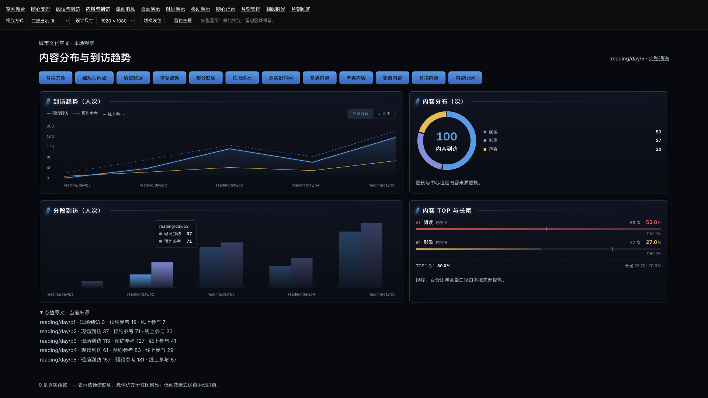
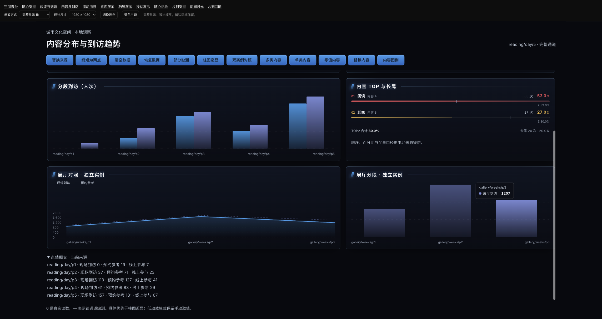
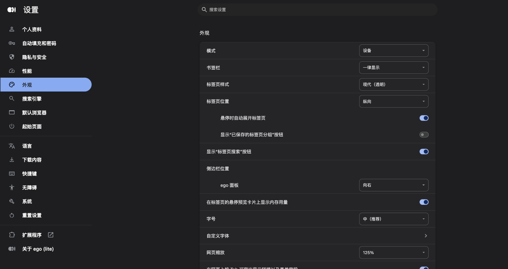

# T05/A05：内容分布与到访趋势

> 后续独立 R1 拒绝集成：F1（P2，继承未修）证明12槽54.1667%的长tooltip仍裁切；原记录保留为实施时点证据。本轮修复、RED→GREEN及新bundle fresh范围见 [F1 证据](f1/README.md)，独立R2尚未执行。

范围为 [#62](https://github.com/Mang-X/nerv-ui/issues/62) 的四图、playground 本组宿主/fixtures/公开测试、四 API 页及串行壳入口 `/#screen/charts`。按已批准母规格 [#1](https://github.com/Mang-X/nerv-ui/issues/1) 和父 [#6](https://github.com/Mang-X/nerv-ui/issues/6) 实施。本记录不等于父票组合验收。

工作树 `/Users/mang/Project/nerv-ui-worktrees/t05-a05-screen-charts`，分支 `feat/t05-a05-screen-charts`。基线 `d9d64bd0c314aad4c11abd1bf6334d145d4b8253`，tree `ec48429a7720e027b45f9f6f893bb362f3e1c9d2`；交付前再次 fetch 并 merge 最新 `origin/integration/nerv-ui-extraction`。最终 head/tree、PR 与命令退出码由外部 `handoff.md` 固定，避免在提交内记录自身 SHA 的循环引用。

原固定来源 `79b1578f2b75f55709765b5e7882aaf33146c603` 未写；本组行为修复留在新库，旧消费者接入时再决定回传。所有命令显式 workdir 为上述工作树，未写自动 Nerv-IIP 工作树、根 checkout 或双 main。

## 公共合同与来源

- 继续从 `@nerv-iip/ui` 主桶与既有 CSS 消费；无新依赖/SDK/auth/API，无导出、包名、冻结素材、tokens、全局覆盖层变动。
- Trend 新增兼容的 `tooltip=false`，省略/undefined 仍用旧 pin；全空不显示历史 1,086/1,150。通道按最长长度共用 x 槽，短数组的末尾缺测为 `—`，真实零为 `0`。保留归一化鼠标横坐标，替换/缩短/恢复数据后重新选当前最近点。实际值缺测时不画伪零圆点。
- `yLabels` 仍是文本而非 scale。宿主按当前所有通道 peak 的既有十进位取整规则生成对应刻度；短/空/缺测也重算。标签中心与 plot 网格同坐标。原默认示例文本和 pin 保留兼容，新宿主显式提供全部中性值。
- Bar 零柱高为 0；缺测不伪造零。动态 autoplay/间隔/点数与媒体偏好均管理同一 timer，hover 优先、leave 恢复，卸载移除 timer 和媒体 listener。正常模式经过第一完整间隔才出现首列；reduced 模式保留鼠标取值。
- Donut 按最大值归一化后求和，单个 0.2 为整圆，两个 `1e308` 仍各半。中心合计来自宿主。Pareto 保输入顺序，Σ 仅累计宿主 pct；条长按最大 count，未传 total 无长尾，显式 total=0 显示零全量长尾。
- 这些仍是数量图。现有 `number[]`/number 类型未收紧、未增加运行时拒绝；有限非负数量用于本例，未新增有符号坐标轴、null/NaN/Infinity 缺口或无限时间序列模型。宿主负责 count/pct/total 同分母、唯一 label 和 source/range/point 身份；业务阈值/汇总/API 留宿主。

## Requirement | Evidence

U 为 `frontend/packages/ui/src/components/screen/ScreenCharts.test.ts`；P 为 `frontend/apps/playground/src/screen/ScreenChartsDemo.test.ts`；壳为 `frontend/apps/playground/src/ScreenDemo.test.ts`。全部通过主桶 mount/setProps、DOM/role/readout 和公开事件观察，不访问 private VM。

| Requirement                                       | Evidence                                                                                                                                                                                                                                                                |
| ------------------------------------------------- | ----------------------------------------------------------------------------------------------------------------------------------------------------------------------------------------------------------------------------------------------------------------------- |
| 默认兼容、显式关闭 pin、empty 无旧读数            | U → `Trend retains its default pin but explicit false and empty data never show historical readings`。原实现 empty 仍露旧 pin RED；最终 GREEN。                                                                                                                         |
| 同点 actual/plan/extra、短缺测、零、缩短/空/恢复  | U → `Trend shares point slots across short series and recomputes a held pointer through short empty and recovered data`。原 plan 缺点读 0 RED；额外短线固定共用 x 槽的已算例坐标，不镜像全算法。                                                                        |
| Bar 缺测、真实零柱高、替换身份                    | U → `Bar shows zero and missing distinctly and held pointer follows replacement slots without old values`。原缺点 0 RED；替换后卡片、empty/recover 与零高 GREEN。                                                                                                       |
| 巡显注册边沿、两步、hover/leave、开关、媒体、清理 | U → `Bar observes timer edges pauses for hover resumes on leave reacts to autoplay and motion and disposes`。原动态关闭仍留 timer RED；119ms 无卡、120ms 首列、再 120ms 次列，动态 reduced/恢复与卸载均断言。                                                           |
| 初始低动效无巡显、手动可读                        | U → `reduced motion at mount never registers autoplay but preserves manual Bar reading`。原对应能力 PASS，补充覆盖不冒称 RED。                                                                                                                                          |
| 最近点边界与同槽各序列                            | U → `Trend nearest point boundaries and Bar same slot expose every current series without borrowing adjacent labels`。已知三点、边界左右和每个通道逐项比较。原对应能力 PASS；mock rectangle 仅证明逻辑，真实坐标另见 browser。                                          |
| Donut 零/单/多/legend/center/替换/有限大数        | U → `Donut preserves subunit and huge finite ratios across zero single reordered and replaced segments with center and legend`。原单段 0.2 只占 20% RED；0、整圆、各半、3:1、重排、legend off 与 empty GREEN。                                                          |
| Pareto 顺序、Σ、分母、未传/0、次单位条长          | U → `Pareto preserves input order and host percentages while distinguishing omitted total from explicit zero`，原最大 count=0.6 只画 60% RED；以及 `Pareto explicit zero total displays a zero denominator tail instead of hiding the summary`，原显式 0 隐藏长尾 RED。 |
| 极大有限几何与独立 defs                           | U → `Trend and Bar retain meaningful finite geometry near the numeric upper bound with isolated instance gradients`。原 1.7e308 的 Trend 取整/Bar 先乘溢出 RED；最终顶点和 128 高柱为已算例值，零柱与自身 defs 引用均断言。                                             |
| range 父 model 实际换数据、量级/点数/来源         | P → `range model switches real source point count scale and all channel readouts then short empty and recover preserve identity`。新宿主首次不存在为接线 RED；实际 reading/day/5→weeks/3、1,307、2,000 刻度、短/空/恢复及 gallery 替换 GREEN。                          |
| 内容分布实际替换与同分母                          | P → `host distribution controls replace donut legend center and Pareto denominator consistently including zero`。多类 100/80%/长尾20，单类23、零值0、替换200/70%/长尾60 的图例、center 与 TOP/Σ 断言。                                                                  |
| 深链、所有已完成分组与离页生命周期                | 壳 → `opens charts deep link preserves all completed sections and disposes autoplay before returning`。原深链只开 stage RED；实际巡显后 stage timer0，重入初始数据，stage/controls/indicators/data 入口保留。                                                           |

最终完整 U 套件在原四图上跑出 **8 FAIL / 2 PASS**，修复后本组 **10 PASS**；精确对象为固定 base 的原四图加最终测试文件，随后在 finally 中恢复工作树源码。`raw/final-tests-original-red.{json,log,exit.json}` 与脚本 `baseline.mjs` 固定该比较。原实现重跑时，最初两个新增覆盖用 role 选择卡片，因原实现尚无 role 而失败；`original-role-selector-fail.*` 保留该接线 FAIL。已改为两版都存在的公开卡片 DOM，原最近点/初始 reduced 对应行为确认为 PASS，不伪造 RED。更早的 pin/slots 命令因主桶导入路径错误而未执行断言（tests=0），保留为 harness FAIL，不能算产品 RED。`charts-baseline-red.json` 的 4 个实际断言失败与逐轮 JSON/日志均保留。

## Fresh 本地门禁

初始无 node_modules，仅 frozen install 一次。task-local `/tmp/nerv-ui-t05-a05/bin/pnpm` 通过 corepack 固定 pnpm 11.22.0，嵌套 PATH 同样固定；未改全局 pnpm。Python 编辑脚本只用 `uv run --python 3.12 -- python`。

```sh
PATH=/tmp/nerv-ui-t05-a05/bin:$PATH pnpm -C frontend install --frozen-lockfile
node /tmp/nerv-ui-t05-a05/handoff/run.mjs ui-final5 -C frontend --filter @nerv-iip/ui test --reporter=json --outputFile=/tmp/nerv-ui-t05-a05/handoff/raw/ui-final5.json
node /tmp/nerv-ui-t05-a05/handoff/run.mjs mobile-final -C frontend --filter @nerv-iip/ui-mobile test --reporter=json --outputFile=/tmp/nerv-ui-t05-a05/handoff/raw/mobile-final.json
node /tmp/nerv-ui-t05-a05/handoff/run.mjs host-final3 -C frontend --filter @nerv-iip/playground test --reporter=json --outputFile=/tmp/nerv-ui-t05-a05/handoff/raw/host-final3.json
node /tmp/nerv-ui-t05-a05/handoff/run.mjs docs-ui-final2 -C frontend --filter @nerv-iip/ui test:docs --reporter=json --outputFile=/tmp/nerv-ui-t05-a05/handoff/raw/docs-ui-final2.json
node /tmp/nerv-ui-t05-a05/handoff/run.mjs docs-mobile-final -C frontend --filter @nerv-iip/ui-mobile test:docs --reporter=json --outputFile=/tmp/nerv-ui-t05-a05/handoff/raw/docs-mobile-final.json
node /tmp/nerv-ui-t05-a05/handoff/run.mjs build-final4 -C frontend build
node /tmp/nerv-ui-t05-a05/handoff/audit.mjs
node /tmp/nerv-ui-t05-a05/handoff/maintenance.mjs
```

最终 UI **728**、mobile **144**、host **114**、静态 docs **6+2**，各 lane exit0；JSON success=true、failed/pending=0、无失败 suite，日志无 Unhandled Errors/Unhandled Rejection。runner 不提供独立 numUnhandledErrors 字段，字段缺席不冒称字段值0。三个活动包 vue-tsc 与生产构建 exit0。维护只查本次文件，精确列表、fmt/lint/diffcheck 与结果见 `raw/maintenance-files.json`；不扩大到冻结素材和历史 raw。

`raw/dependencies-final.json` 对 **16 份完整输入字节**逐份 SHA256/基线比较，未升级依赖；playground/UI/mobile 实际解析同一 Vue realpath。所有公开桶、tokens、A04 helper/Freshness 逐字节不变；其它 A01–A04 组件与 PC NvLineChart/Unovis、#29/#40/#43/#51/#63–#64 均未改。

已有旧 raw 全量 diffcheck exit2、冻结 fmt exit1、CSS parser 与 VueUse PURE/INVALID_ANNOTATION/chunk 警告历史保留，本组 scoped PASS 不覆盖这些历史事实。本轮 jsdom CSS parser 和构建 PURE/chunk 警告也保留原日志。A01/A02/A04 的 P3 不顺修。

## Fresh browser 与最终静态字节

先 T3 preview status/open（about:blank URL 先报 parse error，随后无 URL open 成功）。snapshot 同一步两次原文均为 `Preview snapshot failed: Preview automation snapshot timed out after 15000ms.`，据此切 ego-browser，唯一 TaskSpace16/p1，原生 settings 为 p2。不是新建 Playwright 框架，也不是物理设备。

| Requirement                                          | Evidence                                                                                                                                                                                                                                                                                                                                                                                                                             |
| ---------------------------------------------------- | ------------------------------------------------------------------------------------------------------------------------------------------------------------------------------------------------------------------------------------------------------------------------------------------------------------------------------------------------------------------------------------------------------------------------------------ |
| 1920×1080、1366×768、2560×1080 fit/stretch；精确 0.5 | 最终 `browser-24-matrix.log` / `browser/coordinate-matrix-final.json`：8 组实际 viewport、舞台 transform、scroll/client/bounds、首/中/末 Trend 与 Bar label/各通道值、左右 flip、真实命中及卡片 containment。960×621 的工具栏81px，舞台960×540，fit 精确0.5；stretch 亦实测。                                                                                                                                                        |
| 轴刻度位置与 Bar 轴不出框                            | `browser/layout-red.json`：标签中心误差约8.64px，Bar 标签超面板；`layout-green-final.json`：六个中心误差最大约0.011px，Bar 标签在面板内。最终卡片 CSS 更动后，`layout-final-dist.json` 在1920×1080重新测得最大误差约0.009px，Bar标签仍在面板内。                                                                                                                                                                                     |
| 原生 125% zoom                                       | 最终 `browser-25-native.log` / `native-125-actual.json`：通过 Chromium `chrome://settings/appearance` 的“网页缩放”实际选择125%，截图 `chrome-native-125.png`；应用 DPR2→2.5、visualViewport.scale=1、未用 CSS/pageScale/DPR模拟 zoom；fit/stretch 各6次真实 Input.dispatchMouseEvent 取值/卡片边界通过。`native-zoom-restored.json` 与 settings 回读100%。                                                                           |
| hover 保持时 range→short→empty→recover→来源→缺测     | 最终 `browser-29-held.log` / `held-hover-updates-final.json`：真实鼠标先取明确偏右中点，然后通过公开 DOM button.click 换数据且不再发 mousemove，读数1,307→empty隐藏→恢复→1,703/—/509；`held-hover-input-events.json` 记录更新期间没有 mousemove。公开点击为程序触发，不冒称鼠标同时点击另一处。                                                                                                                                      |
| autoplay 可观察两步、hover/leave/reduced/卸载        | 最终 `browser-26-autoplay.log` / `autoplay-lifecycle.json`：拦截系统 setInterval 注册与真实边沿，首列p1→p2；hover p5 保持两个边沿，leave 下个边沿p3；media reduce 后 active0/无自动卡片、手动仍p3；恢复后离页 active0、媒体listener0。没有固定 sleep 冒充长期运行。                                                                                                                                                                  |
| Donut/Pareto 实际替换、长标签、四主题                | 最终 `browser-27-dual.log` / `distribution-browser.json`：单类23、零值0、替换200、Σ20.5/70.0%、长尾60/30%，legend关/开；完整长标签 DOM 没有横向裁切。`outer-themes.json`：light/dark×neutral/blue 下 screen 背景一致，color-scheme dark。正常与 reduced 分别实测；不是完整笛卡尔积。                                                                                                                                                 |
| 双实例 defs、独立来源、实际内滚动                    | `dual-instance.json`：四个 SVG、5个各自唯一 gradient，fill只指本SVG；真实 wheel 使 charts-scroll scrollTop293.5，document scroll0，两个对照图首/中/末分别是 gallery/weeks 的911/1703/1207及预约值；原图仍是 reading。                                                                                                                                                                                                                |
| 短数字与长标签可读                                   | `short-number-wrap-red.json`：对照 Bar 的1207原被断为2行；`short-number-wrap-green.json`：补 width:max-content 后为1行；最终 `browser-28-wrap-green.log`。两卡保留半区最大宽度、必要时长文本折行，不裁掉值。                                                                                                                                                                                                                         |
| 旧入口、刷新深链、本组卸载                           | 最终 `browser-31-resources.log` / `routes.json`：stage/controls/indicators/data 与7个旧表面均实际导航并返回图表；每个离页本组DOM撤下，reload回初始 reading/day/5；完整旧表面业务链不代验。timer/media另由本组生命周期证据支持。                                                                                                                                                                                                      |
| HTML/JS/CSS/font 为最终 dist 字节                    | 最终 `final-dist-resources.json`：实际页面脚本、CSS、已请求/loaded 的 Inter latin 与 greek 字体，浏览器重新请求均200；完整响应字节与最终dist逐字节比较、记录bytes/SHA256。响应存 browser/resources。未请求的其它字体/资产不认证，字体CSS存在不冒称全部字体已加载。`raw/dist-browser-object.json` 与 `raw/dist-final.json` 进一步对最终重建的全部13份dist文件逐字节SHA256集合比较一致；未加载的文件只证明构建确定性，不认证运行加载。 |

早期 browser FAIL 全保留：首次宿主面板 class 替换未命中导致 wait timeout；精确中线在缩成两点时属于等距浮点边界，错误固定期待右点；原生zoom端点边界的像素量化/高层鼠标输入失败，随后在 plot 内侧2px 用真实 CDP Input 复验；字体从缓存加载导致 encodedBodySize=0 的过严证据断言也保留；最终结合 responseStatus=200、FontFace loaded 与完整响应字节验证。以及两个实际布局 RED 与短数字折行 RED。只有上表最终 clean 轮次记 PASS，未删除早期失败日志。媒体偏好通过浏览器仿真，不冒称操作系统设置；原生 zoom 则经真实设置页操作。





## 交接边界

原始命令、RED/GREEN/FAIL、完整 lane JSON/日志、浏览器脚本/响应/截图在 `/tmp/nerv-ui-t05-a05/handoff/`；durable 副本 `/Users/mang/nerv-delivery-evidence/nerv-ui/2026-10-25/t05-a05-implementation/` 附 SHA256SUMS，排除 node_modules、cleancheckout、.vite 与 cache。最终 handoff 固定 exact head/tree/base、PR URL、清理状态和本地证据。

CI 未取得结果，packed #11、完整文档站 #10、设备/模拟器、旧库接入、生产与父 #6 组合均 **UNRUN**。独立 merger 尚未运行。本任务只 push 并提中文 PR 到 integration，不 merge、不关闭 #62/#6/#1、不 ready #18、不监控。浏览器/自有4195服务交付前清理；原生 zoom 恢复100%，worktree保持clean，留给独立 merger。
