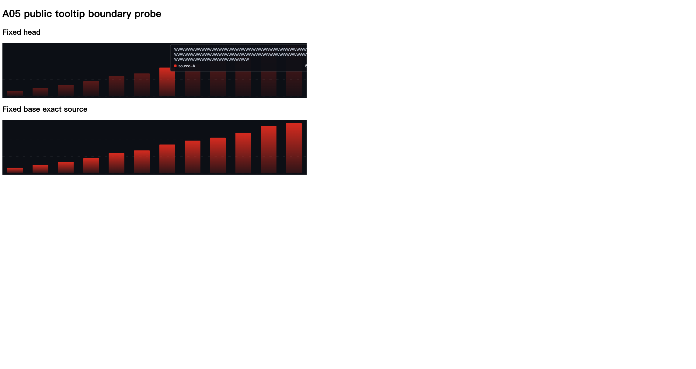
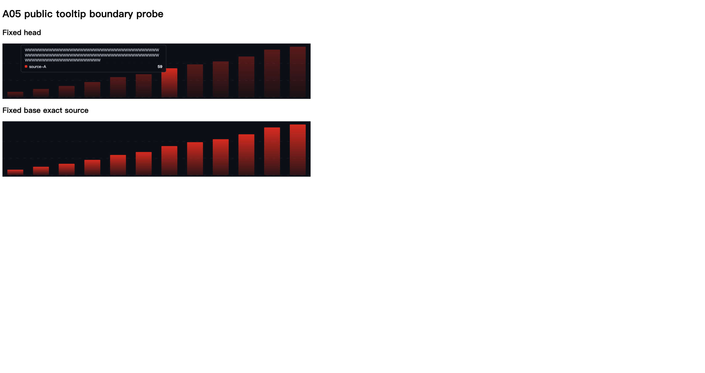

# T05/A05 F1：柱图中点右侧 tooltip 裁切

仅修 [#62](https://github.com/Mang-X/nerv-ui/issues/62) / [PR69](https://github.com/Mang-X/nerv-ui/pull/69) 独立 R1 的 F1（P2，继承未修）。R1 **拒绝集成**结论保留：Standards material0/optional0、Spec material1/optional0、新增material0。本轮是实施自验，独立 R2 **UNRUN**。

## 固定对象与最窄改动

- 工作树 `/Users/mang/Project/nerv-ui-worktrees/t05-a05-screen-charts`，branch `feat/t05-a05-screen-charts`。全部 shell 显式使用此 workdir。
- integration base `d9d64bd0c314aad4c11abd1bf6334d145d4b8253` / tree `ec48429a7720e027b45f9f6f893bb362f3e1c9d2`。交付前 fetch/merge 最新 integration。
- 受拒 head `119d4a60f9fcd41bd33c746aa6ccdce348c5446b` / tree `2e83e4fc1d6a9832b38228aa5792a604ec89f4ca`。最终新 head/tree 在仓外 handoff 固定，避免自引用。
- 生产仅修改 `ScreenBarChart.vue` 的 flip 阈值 **55→50**，加注释说明与半区最大宽一致。CSS、API/default、数据槽、hover 身份、autoplay/media/timer 均未改；没有删长标签、限制输入长度、fixture 覆盖样式或新框架/依赖。

卡片 `max-width:calc(50% - 28px)`，10px 位移；右半区槽中心应向左。第7/12槽54.1667%原未翻转，最大宽卡片超过右边界。最窄修复对齐半区，正中点仍向右。自然高度与现有换行保留；overflow:hidden 宿主为折行 label、全部序列行、顶部4px留足高度，不新增裁字、line-clamp、内部滚动。100W 双序列600×180、三序列400×240为有效高度样本，不扩为任意标签/任意小图表框架。

## Requirement | Evidence

| Requirement                 | Evidence                                                                                                                                                                                                                                                                                              |
| --------------------------- | ----------------------------------------------------------------------------------------------------------------------------------------------------------------------------------------------------------------------------------------------------------------------------------------------------- |
| 原公开12槽反例先RED再GREEN  | 正式公共测试 `Bar places slot 7 tooltip into the available half without changing its label or readings`：受拒源码 false≠true，唯一失败，修后通过。真实鼠标 `browser-red.mjs` / `browser-green-original.mjs` 使用同一1000×180 overflow:hidden消费者、100W第7label/读数59，base由原始完整源码单独挂载。 |
| 首末与中点邻域              | 上述参数化测试精确名称中的 slot **1、6、7、8、12**，labels/读数分别11/47/59/67/103，mouseleave撤下；`Bar keeps the exact midpoint tooltip on the right with all current series readings` 断言正中点向右、label middle与17/31。                                                                        |
| 真实长label与完整读数       | `consumer-matrix.json` **60**样本：1000×180/1序列、600×180/2序列、400×240/3序列/100W，400×180/2序列/短label；每组 none/fit/stretch ×首/6/7/8/末。实际input命中、card bounds、DOM Range每行label/全部b都在card与host内；100W完整多行、读数单行。无仅textContent存在就判PASS。                          |
| 原生125%消费者              | `consumer-native125.json` 同矩阵60样本；Chromium设置页真实选125%，DPR2.5、visualViewport.scale1，CDP真实mouseMoved，settings截图；finally恢复100%、DPR2/vv1。没有CSS/pageScale/DPR仿真代替原生zoom。                                                                                                  |
| 新生产bundle取值/range/缩放 | `production-browser.json` **24**样本：100%/真实125% ×fit/stretch；Bar首中末与Trend中点；day→weeks后Bar1307/1409、Trend1,307/1,409/509，检查card/label/readout边界。生产宿主没有12槽100W fixture，原反例由独立主桶公共消费者证明。                                                                     |
| 原逻辑避免退化              | 官方本组16PASS（原10+本轮6）；R1公开 `P01`–`P09`（P04 small/ordinary/upper）共11PASS，含MAX_VALUE/MIN_VALUE、重排、0/缺测、held/empty/recover、timer/media/defs与Donut/Pareto。                                                                                                                       |
| 实际响应属于最终dist        | `production-resources.json` 实际5响应：HTML、JS、CSS、2份已加载Inter字体，均200/完整字节等于dist；`dist-browser-object.json`与最终重建13份集合逐文件bytes/SHA256相同。scratch消费者源码/配置/base字节独立归档，不冒称production bundle。                                                              |

## 原反例实际边界

本轮 fresh RED 与 R1完全一致：host left8/right1008；head card left559.6640625/right1031.6640625，右溢 **23.6640625px**、flip=false、100W/59。base card right1701.6640625，溢 **693.6640625px**。

GREEN 同一消费者：host仍right1008；card left **67.6640625**/right **539.6640625**/width472、flip=true；100W三行、59完整可见。base依旧FAIL，不被新PASS覆盖。





窄图/多序列样本另存每行文本矩形和截图。第三序列只作既有数组渲染的额外回归，不把文档建议1–2条改成新API。

## Fresh本地门禁与维护范围

依赖已存在，未install/升级。task-local shim为 `exec corepack pnpm@11.22.0 "$@"`，嵌套PATH固定；本轮未使用Python，未装全局包。

```sh
node /tmp/nerv-ui-t05-a05-f1/handoff/run.mjs f1-red -C frontend --filter @nerv-iip/ui test ScreenCharts --reporter=json --outputFile=/tmp/nerv-ui-t05-a05-f1/handoff/raw/f1-red.json
node /tmp/nerv-ui-t05-a05-f1/handoff/run.mjs f1-green -C frontend --filter @nerv-iip/ui exec vp test run src/components/screen/ScreenCharts.test.ts --reporter=json --outputFile=/tmp/nerv-ui-t05-a05-f1/handoff/raw/f1-green.json
node /tmp/nerv-ui-t05-a05-f1/handoff/verify.mjs
node /tmp/nerv-ui-t05-a05-f1/handoff/audit.mjs
node /tmp/nerv-ui-t05-a05-f1/handoff/maintenance.mjs
```

首次RED命令实际跑完整UI734（追加的ScreenCharts参数未缩小已有src范围），733PASS/1FAIL，确为slot7公开断言。GREEN定向16、完整UI **734**、mobile **144**、host **114**、静态docs **6+2**、公开probe **11**，均exit0、JSON success=true、failed/pending/failedSuites0；日志无Unhandled Errors/Rejection。runner独立unhandled字段缺席，不写成字段值0。三活动包vue-tsc与生产build exit0。精确命令/exit与完整JSON/log在raw。

维护仅本PR相对固定base的文本与本轮文档，精确列表及fmt/lint/scoped diffcheck在 `raw/maintenance-files.json`。16份manifest/lock/workspace完整字节与base相等，三个活动消费者同一Vue realpath；bar以外三图、主桶、tokens、CSS、A01–04与PC/Unovis等owner相对受拒head未改。

## 继承、FAIL、UNRUN与交接

- 原A05实施8组矩阵、native125共12点、完整巡显/低动效/卸载、双实例、分布与路由是 **inherited**；本轮未重跑全部浏览器链。源码仅Bar flip变动，但新JS/hash已变化，旧8组/12点不冒称新bundle fresh。本轮production24点与consumer120点有独立source/产物对象。
- R1/base FAIL、原实施8FAIL2PASS、全部旧harness/browser FAIL、旧raw全量diffcheck2、冻结fmt1、CSS parser/PURE/INVALID_ANNOTATION/chunk警告全部保留；不顺修旧P3。
- 本轮保留：vite命令不存在的probe启动接线、初次browser ERR_CONNECTION_REFUSED；probe经/tmp路径报Cannot find module '/review.test.ts'、零测试，改/private/tmp配置后11PASS；文档生成模板转义失败及其后缺文件fmt失败（均非产品RED）。T3 preview同一步两次原文 `Preview snapshot failed: Preview automation snapshot timed out after 15000ms.` 后切ego，无新browser框架。
- CI无结果；packed #11、完整文档站 #10、设备/模拟器、旧消费者/生产、父 #6组合及独立R2 **UNRUN**。桌面自动化不当作设备证据。
- 不merge、不关闭#62/#6/#1、不ready#18、不监控。旧源79b1578与双main不写；自有browser/service清理、zoom100%，clean工作树交独立R2。

本轮完整归档 `/tmp/nerv-ui-t05-a05-f1/`，`handoff/raw`保留fresh/FAIL；durable `/Users/mang/nerv-delivery-evidence/nerv-ui/2026-10-25/t05-a05-f1/` 排除node_modules/cleancheckout/cache/.vite、附SHA256SUMS。原R1完整receipt、browser-host/probe.js/base-bar.vue、browser02、tooltip-boundary.json/截图位于 `t05-a05-review-r1/`；原实施位于 `t05-a05-implementation/`，均不改写。最终head/tree/base/PR与清理回执由本轮handoff.md固定。
