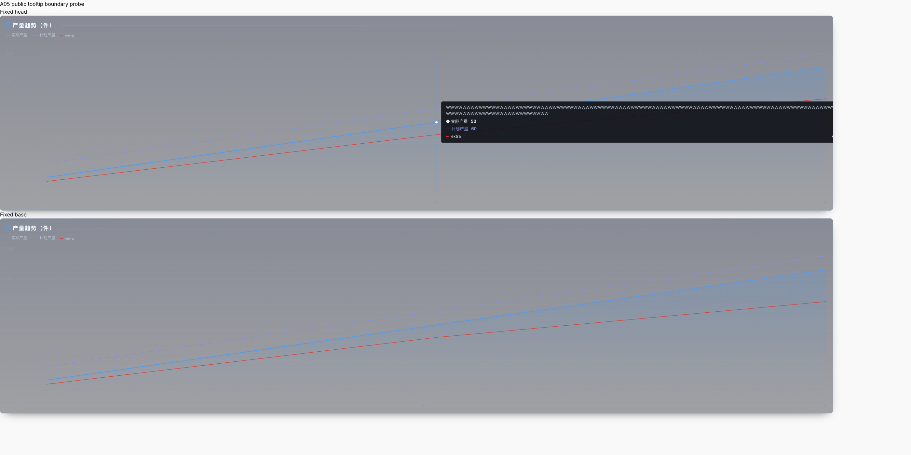
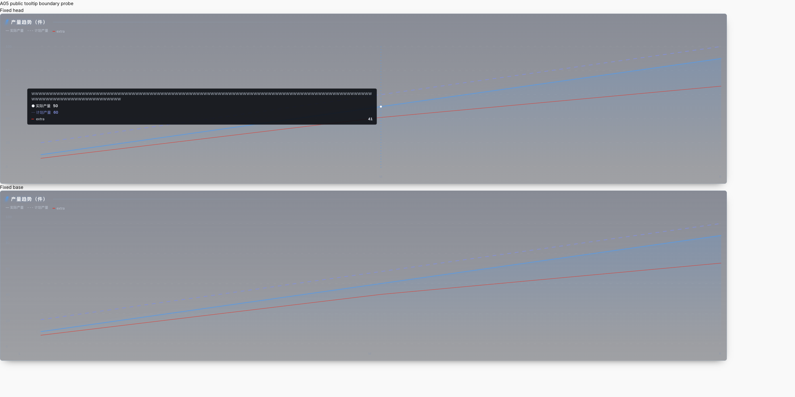
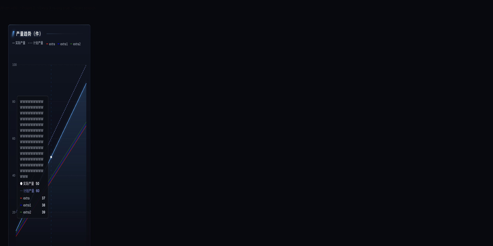

# T05/A05 F2：趋势中点 tooltip 裁切修复

仅处理 #62 / [PR #69](https://github.com/Mang-X/nerv-ui/pull/69) 的 R2 F2。运行源码相对受拒 R2 只有 `TrendChart.vue` 的半宽判断与注释变化。Bar F1 修复不回退，CSS、公开 props/default/主桶、数据、hover、timer、其它 owner 和依赖不变。独立 R3 尚未执行，不以本席验证代替独立集成审核。

## 固定对象与分类

- base/integration：`d9d64bd0c314aad4c11abd1bf6334d145d4b8253` / tree `ec48429a7720e027b45f9f6f893bb362f3e1c9d2`。
- 受拒 R2：`decdc3afc7a577cee4c6f91bc8da4e2d9540c2ba` / tree `b8fc01540698d4d55b127c2105d16378c4e7d985`。Standards material0/optional0、Spec material1/optional0；F2=P2 **继承未修、本轮 R2 新发现**，非新增回归。
- 受拒 R1：`119d4a60f9fcd41bd33c746aa6ccdce348c5446b` / tree `2e83e4fc1d6a9832b38228aa5792a604ec89f4ca`；原 Bar F1 已经修复并获 R2 确认。原 consumer120 / production24 仍按 F1 历史身份继承，不冒充本次 Trend 验证。
- 本轮交付 head/tree 由同 PR 和 raw `final-object.json` 精确定位。没有 merge SHA；不关闭 #62/#6/#1、不 ready #18、不监控。A01–04/#63–64/T08/PC#31/#43/#51/冻结区不扩。

## RED → GREEN 与边界

公开主桶 `NvScreenTrendChart` + `@nerv-iip/ui/styles.css`，原反例完整保留：root 2560×600、border-box、overflow:hidden；actual `[10,50,90]` / plan `[20,60,100]` / extra `[7,41,67]`；tooltip=false、tabs=false；hoverLabels 为 L/120W/R；六个 yLabels 为 100/80/60/40/20/0。viewport **2800×1400 CSS px** 完整容纳宿主；DPR2、visualViewport.scale1、CSS zoom1，真实 CDP mouse 命中 SVG。

- RED：正式公开测试 17 例中仅新中点测试 FAIL（false≠true），其余16 PASS。真实 card left1355.65625/right2587.65625，对 host right2560 右溢 **27.65625px**；extra `41` 的文字 Range right2572.65625，裁 **12.65625px**。脚本收集 exit0 不当作产品 PASS。
- GREEN：同一输入、同一 viewport，card **left95.65625/right1327.65625/width1232/height128.25**，flip=true。120W 全文两行，最右文字1309.453125；全部读数50/60/41的 Range、卡片与全文均在 card/host 内，真实 hit=true。
- 固定 base 原始 Trend 文件字节不变，依赖 ScreenPanel 字节与 base 相同；同轮 base card right2900，仍溢340px **FAIL**。传新增 false API 的 base prop 警告保留；本次依赖真实 hover 分支，不改 base 源码。





根因：plot 的左轴沟为46，plot中点493/940=52.4468%，但 HTML 卡片 max-width 相对完整 body 半宽。翻转改用 `cx > VB_W / 2`，与锚点 `cx/VB_W`、border-box 最大宽 `W/2-28` 同层同基准。gap14：向右且锚点≤W/2时 right≤W−14；向左且锚点>W/2时 left>14。150px min-width 与最大宽同时成立需内部 W≥356（默认面板外宽≥396）。不改文字、不删 extra、不限制合法 label，不新增图表模型。

高度仍是自然内容，由宿主留足空间。公开矩阵400宽/120W/3条extra需要800高：原600高样本卡高398.75，偏左点 card bottom684.1328125 > host672，该容量 FAIL 在 raw 单列保留。加高后沿用全部可见断言；没有把高度容量失败抹去或声称任意文本/任意小容器均能容纳。原2560×600反例不变。

## Requirement / Evidence

| Requirement                  | Evidence                                                                                                                                                                                                                                                                                                                                                                                                                                |
| ---------------------------- | --------------------------------------------------------------------------------------------------------------------------------------------------------------------------------------------------------------------------------------------------------------------------------------------------------------------------------------------------------------------------------------------------------------------------------------- |
| 原中点完整标签与附加值       | `Trend opens the plot midpoint card into the available container half with its full label and extra reading`：正式 RED17中1FAIL→GREEN17PASS；最终本组26PASS。真实 `red-real.json` / `green-real.json` 对照与上图。                                                                                                                                                                                                                      |
| 三点首末                     | `Trend places point 0 of 3 into the available container half with current readings`、`Trend places point 2 of 3 into the available container half with current readings`。                                                                                                                                                                                                                                                              |
| 五点中点及左右邻点           | `Trend places point 1 of 5 into the available container half with current readings`、`Trend places point 2 of 5 into the available container half with current readings`、`Trend places point 3 of 5 into the available container half with current readings`。                                                                                                                                                                         |
| 细分点数、容器半宽附近       | `Trend places point 18 of 41 into the available container half with current readings`、`Trend places point 19 of 41 into the available container half with current readings`、`Trend places point 20 of 41 into the available container half with current readings`、`Trend places point 21 of 41 into the available container half with current readings`。其中第19点 cx470.65 已超过容器半宽470，须向左；第18点448.3向右。            |
| 真实 card/全文/全部读数可见  | `consumer-matrix.json` 84例、`consumer-native125.json` 84例：400/600/1000/2560；3/5/12/41点；none/fit/stretch；长短标签；0–3条extra。首/中/邻/末，真实 hit、hostInViewport、card、全部文本 Range、每个b读数及单行性全断言。原生125%通过真实 Chromium settings，DPR2.5/vv1/CSSzoom1；恢复100%。                                                                                                                                          |
| 保持鼠标替换/重排/短/空/恢复 | `held-inputs.json`：公开键盘/范围按钮更新 props，只有一次真实 mousemove，未再移动/leave；d2=50/60/A41/B43 → w2=1307/1409/B509/A211 → s2=37/—/— → empty无卡 → r1=0/—/A17，全可见。正式 `Trend shares point slots across short series and recomputes a held pointer through short empty and recovered data`、公开probe `P02 Trend held pointer follows series reorder and empty recovery without previous source readings` 均fresh PASS。 |
| 兼容、其它原公开行为         | 本次重新执行原公开probe11；`P03 Trend retains default and undefined pin and explicit false disables only resting card`，以及P01/P04三数量级/P05–P09均PASS。Bar原6条F1正式回归保留于完整UI744、本组26。                                                                                                                                                                                                                                  |
| 新生产 bundle 当前值/坐标    | `production-browser.json` 24例：1920×1200 CSS viewport、100%/真实125%、fit/stretch；Bar首中末与Trend中点、day→weeks的1307/1409/509。全部真实命中、label/每个读数Range/card均在host中。scratch消费者与正式bundle分开。                                                                                                                                                                                                                   |
| 完整门禁                     | UI744、mobile144、host114、静态docs6+2、公开probe11，最终本组26；各exit0/JSON success=true、failed/pending/failedSuites0、日志无Unhandled，独立unhandled字段缺席不伪写字段0。三活动包vue-tsc及正式build exit0。                                                                                                                                                                                                                         |
| 产物和依赖身份               | 670运行源码只Trend相对R2有delta；16份manifest/lock/workspace全字节=base；三个消费者同一Vue realpath，无install/升级。13 dist完整集合bytes/SHA256；实际5 loaded响应=HTML/JS/CSS/2个Inter字体，均200且完整字节=dist。新JS为 `index-BkoG3Pp9.js`，F1旧JS `index-CuvOPwJc.js` 仅继承。                                                                                                                                                      |



## 命令与回执

所有 shell 的工具 workdir 显式为 `/Users/mang/Project/nerv-ui-worktrees/t05-a05-screen-charts`，branch `feat/t05-a05-screen-charts`；只读核对 root 的 integration，未写默认旧Nerv-IIP/root/双main。固定shim `exec corepack pnpm@11.22.0 "$@"` 放在本轮PATH首位，不使用默认pnpm版本，不运行Python/pip。

精确完整 argv/cwd/exit 在 `handoff/raw/*.exit.json`，stdout/stderr/JSON并存。`run.mjs` 保留真实 runner exit，不用日志过滤返回值冒充成功。

```sh
node /tmp/nerv-ui-t05-a05-f2/run.mjs formal-red -C frontend/packages/ui exec vp test run src/components/screen/ScreenCharts.test.ts --reporter=json --outputFile=/tmp/nerv-ui-t05-a05-f2/handoff/raw/formal-red.json
node /tmp/nerv-ui-t05-a05-f2/run.mjs formal-final -C frontend/packages/ui exec vp test run src/components/screen/ScreenCharts.test.ts --reporter=json --outputFile=/tmp/nerv-ui-t05-a05-f2/handoff/raw/formal-final.json
node /tmp/nerv-ui-t05-a05-f2/run.mjs ui -C frontend --filter @nerv-iip/ui test --reporter=json --outputFile=/tmp/nerv-ui-t05-a05-f2/handoff/raw/ui.json
node /tmp/nerv-ui-t05-a05-f2/run.mjs mobile -C frontend --filter @nerv-iip/ui-mobile test --reporter=json --outputFile=/tmp/nerv-ui-t05-a05-f2/handoff/raw/mobile.json
node /tmp/nerv-ui-t05-a05-f2/run.mjs host -C frontend --filter @nerv-iip/playground test --reporter=json --outputFile=/tmp/nerv-ui-t05-a05-f2/handoff/raw/host.json
node /tmp/nerv-ui-t05-a05-f2/run.mjs docs-ui -C frontend --filter @nerv-iip/ui test:docs --reporter=json --outputFile=/tmp/nerv-ui-t05-a05-f2/handoff/raw/docs-ui.json
node /tmp/nerv-ui-t05-a05-f2/run.mjs docs-mobile -C frontend --filter @nerv-iip/ui-mobile test:docs --reporter=json --outputFile=/tmp/nerv-ui-t05-a05-f2/handoff/raw/docs-mobile.json
node /tmp/nerv-ui-t05-a05-f2/run.mjs public-probe-realpath -C frontend exec vp test run --config /private/tmp/nerv-ui-t05-a05-f2/probes/vite.config.mjs --reporter=json --outputFile=/tmp/nerv-ui-t05-a05-f2/handoff/raw/public-probe-realpath.json
node /tmp/nerv-ui-t05-a05-f2/run.mjs build -C frontend build
node /tmp/nerv-ui-t05-a05-f2/verify.mjs
node /tmp/nerv-ui-t05-a05-f2/audit.mjs
node /tmp/nerv-ui-t05-a05-f2/maintenance.mjs
```

维护范围为PR相对固定base的17份文本fmt/10份源码lint，以及固定范围diff-check。原RAW2/冻结fmt1、CSS parser/PURE/INVALID_ANNOTATION、原base四图8FAIL2PASS、R1/R2拒绝及所有历史harness错误保留；本轮高度容量FAIL、native viewport错误、MouseEvent整数分界接线与/tmp probe接线详见 `raw/harness-errors.md`，不改称产品 RED。

## 证据身份与交付边界

- **Fresh**：上述正式门禁、168消费者样本、5态held、新bundle24样本与实际5响应/13dist。
- **Inherited**：R1 F1 consumer120/production24、原四图8组browser矩阵/native12点、完整autoplay/hover/reduced/dispose、双实例defs、Donut/Pareto分布/四主题/11routes。它们属于历史源码或旧bundle身份，未冒称本次新bundle完整重跑；本次公共逻辑probe11为fresh，原FAIL不被后续PASS抵消。
- **UNRUN**：独立R3、CI（无结果）、packed#11、完整文档站#10、设备/模拟器、旧库接入/生产、父#6组合。桌面自动化不当设备证据。
- 无扩大模型的未决技术异议；自然高度容量和内部最小宽是明确边界。留工作树给独立R3；自有服务/browser清理、原生zoom恢复100%。

临时完整脚本/输入/日志/截图：`/tmp/nerv-ui-t05-a05-f2/`，交接 `handoff/handoff.md`、`handoff/raw/`。Durable：`/Users/mang/nerv-delivery-evidence/nerv-ui/2026-10-25/t05-a05-f2/`，排除node_modules/cleancheckout/cache/.vite，附SHA256SUMS。

原证据保持原址：`t05-a05-review-r1/`、`t05-a05-f1/`、`t05-a05-review-r2/` 和 `t05-a05-implementation/`；仓内 [F1证据](../f1/README.md)、[原实施证据](../README.md) 不改写历史。
