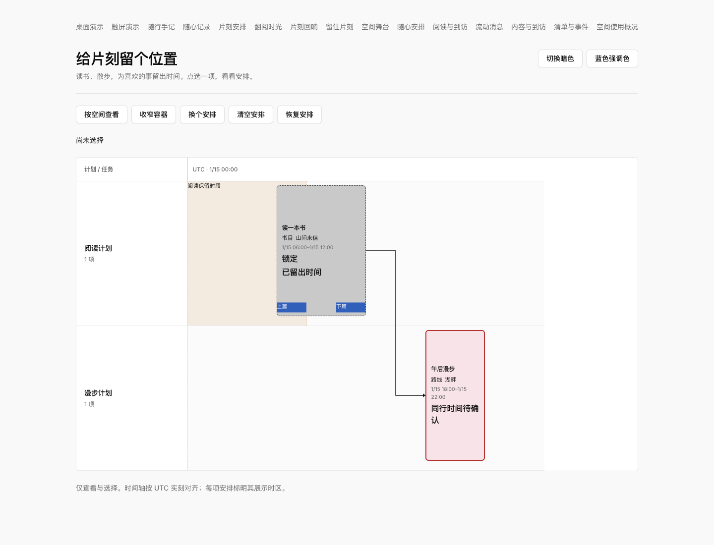

# T07/P01：原生只读时间轴实施证据

本记录只交付 [#84](https://github.com/Mang-X/nerv-ui/issues/84)，scope:M，单 PR；[#8](https://github.com/Mang-X/nerv-ui/issues/8) 的其它 15 叶和父组合验收另列。独立 merger 尚未运行，不宣称已验收或已集成。

## 固定对象与范围

- 工作树 `/Users/mang/Project/nerv-ui-worktrees/t07-p01-native-timeline`，分支 `feat/t07-p01-native-timeline`。开工 clean；base `93f9689cae554ea87ca6cb2a28a56b2f11f14f32` / tree `74e5607188826c0a48f7bbbf1474ba0fbf822bdc`。交付 SHA/tree 以 PR 与 durable `handoff.md` 为准，避免在本文件自引用提交。
- `@nerv-iip/ui` PC 层新增 `NvScheduleTimeline`、库自有 visual types、样式及主桶导出；playground 新增 `/#schedule`，桌面可进入，原入口保留。无 package/config/lock 改动，无 SDK、vendor 或 scheduling workspace 恢复。
- 原生来源 `frontend/packages/scheduling/src/components/ReadonlyScheduleTimeline.vue`，blob `0c54d9a646374a6c987304e1ea57e32bce3c5df7`；原文件及 migration 未改。新库 ui 是活动 native renderer owner，P04/#87 后续复用同一实现。
- 旧源 local HEAD `79b1578f2b75f55709765b5e7882aaf33146c603` / tree `58e30c637acb7efdd393af291e570288b03b5aa9`，本轮只读且 clean。另一次远端只读 `ls-remote` 得到旧库 main/HEAD `7b7bbb4fbc41970bb7e17392daf196a0fc72eb6f`，二者不能混同；未 fetch/改旧 refs。新库 main 保持 `599031a688496679e300458f56a1896d41ac8f81`。

保留轴/网格、重叠排布、任务/资源泳道、空泳道排序、依赖 SVG、窗口投影、锁定/冲突/独立风险强调/事实和选择。分段带是本票显式要求的 visual 展示补齐，旧 native SFC 本身没有绘制 segments，不能冒称逐字继承。资源 blocks、周/月独立刻度、zoom/drag/command 并非该 native 来源已支持能力。宿主给出事实、标签、窗口和实际 UTC/offset 时刻；组件不推导生产日历、权限、风险或领域算法。未解析时区显式显示，备用轴明确为 UTC。

六件套及字段合同见[决策页](../../../frontend/DESIGN/components/schedule-timeline.md)、[文档页](../../../frontend/apps/design-system/docs/components/desktop/schedule-timeline.md)、`frontend/DESIGN/{nvui-naming-map,component-coverage}.md` 和源码主桶。

## 本轮 fresh 门禁

所有 shell 都显式指定本工作树。task-local shim 固定 corepack `pnpm@11.22.0`，包含 nested pnpm。最终全量测试按以下顺序串行，退出码均为 0：

| 门禁 | 结果 | 复现入口（仓库根） |
| --- | --- | --- |
| frozen install | PASS | `pnpm -C frontend install --frozen-lockfile` |
| UI 行为与契约 | 805 PASS | `pnpm -C frontend --filter @nerv-iip/ui test` |
| mobile 行为/命名 | 144 PASS | `pnpm -C frontend --filter @nerv-iip/ui-mobile test` |
| host 全量 | 267 PASS | `pnpm -C frontend --filter @nerv-iip/playground test --fileParallelism=false` |
| 文档源码 | 6 + 2 PASS | UI `test:docs`；mobile 单独运行 `src/nvui-doc-coverage.contract.test.ts` |
| 三包类型 + 根 base 构建 | PASS | `pnpm -C frontend build` |
| 非根 base 构建 | PASS | `pnpm -C frontend --filter @nerv-iip/playground exec vp build --base=/p01-proof/` |
| 受影响源码/新文档 fmt、源码 lint | PASS | 精确参数见 durable `raw/{fmt-candidate,lint-candidate}.run.json` |

[summary.json](raw/summary.json) 对照真实 JSON 的 `success`、失败断言/失败 suite、各文件 status 与 exit；该 reporter 没有 unhandled 计数字段，因此保留 null，不伪称字段为 0。五份最终日志未发现 unhandled error/rejection 文本；jsdom 的 stylesheet 解析告警保留。构建的 crypto browser-external、VueUse PURE annotation 和大 chunk 告警保留，未更改阈值。

[16 份工程输入](raw/dependency-integrity.json) 与 base 全字节相同，故完整 973 packages / 973 snapshots 及所有解析边、peer/optional 字段未升级；三个活动包的 Vue realpath 相同。最终构建未发现 SDK、vitest runtime 或 DHTMLX 标记。测试并未依赖旧 private Vue 深导入。[源码指纹](raw/final-source-sha256.json) 把浏览器和门禁对应到 13 份受影响 frontend 文件。

## Requirement / Evidence

以下测试都在 bare `@nerv-iip/ui` root export 或实际 App 宿主接缝运行；名称对应最终 host 报告。

| Requirement | 测试名 / 独立证据 |
| --- | --- |
| 两个中性任务、一依赖；轴/标签/坐标与 taskId | `root export renders two neutral tasks at fixed instant coordinates and emits their task identity` |
| 同 key 文本、facts、分段、links、窗口、资源更替与 clear | `replaces same-key labels facts segments links windows and resources without retaining old content` |
| readonly 不编辑、不突变输入 | `readonly selection never edits or mutates frozen caller data`，深冻结输入和真实浏览器手势 |
| UTC/offset、未解析时区、拒绝无 offset wall time | `keeps unresolved zones explicit and rejects wall-time tasks without guessing a browser timezone` |
| 风险强调独立于冲突事件 | `shows host attention separately from conflicts and never emits a conflict action for attention alone`；T3 实测 attention 2px、普通任务 1px，回读 taskId |
| 原生空泳道、重叠排布、刻度选择 | `preserves catalog empty lanes overlap stacking and explicit native scale choices` |
| 深链、选择回读、卸载重入、旧入口 | `opens schedule deep entry selects a task and returns through desktop and all previous routes`；[16 入口实际遍历](raw/old-routes-r2.json) |

## 真实浏览器

T3 preview 先 status/open；snapshot 同一步两次 `Preview automation snapshot timed out after 15000ms.`，按授权切到 ego-browser 0.6.1.9，无升级。末轮 T3 DOM 读取、点击、resize、拖动和 HTTP 回读可用，已在补齐 attention 后的最终构建重新执行；snapshot 的旧失败仍保留。首轮 Ego 截图为继承布局证据（默认模型未变，末轮 T3 重核相同几何与 computed style），不冒称截图来自最后 JS 字节。最终几何不用 toolbar/class 自证：

- [四态测量](raw/final-four-states.json)：1440×1100 与 640×1100、明暗主题。720px track 上 read 的 left/width 为 180/180px，walk 为 480/120px；两个 2h 分段各 60px、相对偏移 0/120px。SVG 路径固定坐标 `[360,140,420,432,480]`；实际非零路径几何。窄容器 560px 内横向滚动后分别点击 read/walk，回读对应 taskId；屏外任务没有被误称命中。
- 末轮实际换模型、清空/恢复、同 key 文案/事实/分段/依赖/窗口移除无旧内容；attention 与 conflict 独立，风险任务测得 2px 边框而普通任务 1px。末轮真实拖动后任务坐标不变、无编辑输入。首轮换空间、双击和 Delete 记录另保留，未宣称末轮重做这些手势。
- 15 个既有显式入口逐一打开真实内容并经桌面返回时间安排，native 确实卸载，重入清空选择；另验 `#screen` 别名，共 16 个。
- 根 `/` [9 个响应](raw/root-responses.json) 与非根 `/p01-proof/` [8 个响应](raw/nested-final-responses.json)：对页面实际加载 URL 由浏览器 no-store GET 读取 body，核对 status/MIME/字节/SHA-256 与对应最终 dist。非根 PNG/JPEG 实际解码为 640×400，并测得非零可见几何；不是按扩展名推定 MIME。只覆盖这些实际响应，不外推全部旧文件功能。
- 首轮 Ego 捕获的 459 条 CDP 事件中 `Runtime.exceptionThrown` 为 0，仅限原捕获窗口，不外推末轮 T3 未提供的异常计数。T3 两个自有 tab 与 Ego TaskSpace 48 均已关闭；emulation 清理、scale 恢复 1；本票 4177 服务已停止。

[宽暗](screenshots/final-wide-dark.png) · [窄亮](screenshots/final-narrow-light.png) · [窄暗](screenshots/final-narrow-dark.png)

## RED / FAIL / UNKNOWN 原样保留

完整原始报告、脚本和退出码保存在 durable，而非把后续 PASS 覆盖为第一次就通过：

| 首次记录 | 原因 / 后续边界 |
| --- | --- |
| `red-attention`：5 PASS / 1 FAIL | 公共风险文字缺失；新增宿主 attention 展示字段，保留强调、避免误发 conflictClick；聚焦 7 GREEN |
| `red-public`：1 FAIL | 旧 root 缺 `NvScheduleTimeline`；同 public seam 后续 GREEN |
| `green-public`：1 FAIL | SVG 浮点字符串末位差异；改用独立固定数值与精度比较 |
| `green-focused`：5 PASS / 1 FAIL | Test Utils 对 pointer `clientX` 只读字段赋值报错；改为原生 MouseEvent 初始化 |
| `ui-tests`：804 PASS / 1 FAIL | 命名契约扫描局部 barrel；补标准局部导出，未放宽断言 |
| `host-tests`：256 PASS，2 suite 收集 FAIL | formatter 使模板恢复操作失去分号；窄 probe 复现后移入具名 restore，完整重跑 266 PASS |
| `time-text-red` / `segments-geometry-red` | 文案 103/97px 裁切、分段受 task padding 缩窄；允许换行并按任务完整时间包络投影，最终四态核对 |
| `fmt-evidence` / `fmt-evidence-r2` | 根 evidence 文档不在 vp 的 frontend workspace：`..` 路径被拒、根执行找不到 package；两次工具失败保留，仅人工与 diff-check 核验，不称该文件 fmt PASS |
| 末轮 T3 导航即时读取失败 | hash 已变而 hashchange 尚未完成；改等待公开标题/卸载，不调测试 timeout；16 入口重新 PASS |
| preview 两次 timeout、about:blank 非法 URL、服务启动期 chrome-error、`round06` 定位歧义 | 原始工具失败保留；纠正 URL/按规则 fallback/按可见“桌面演示”收窄，未修改产品绕过 |

full RAW（新库 main `599031a6` → staged candidate）diff-check 退出 2，原始日志 1785 行，来自继承的 integration 证据、PDF/vendor 等空白；P01 全量（含本票 raw JSON）diff-check 与 maintenance 各退出 0。三条 receipt 分开保存，没有改历史 raw 来变绿。

早期 focused naming 与 mobile 运行有 1648ms 重叠，保留各 start/finish；最终五条全量测试已重新严格串行。没有改 timeout、跳 case 或清掉失败。

历史 T06 的默认 host 并发 FAIL 根因仍 **UNKNOWN**，本票未复现或修复；来源指针 `/Users/mang/nerv-delivery-evidence/nerv-ui/2026-10-25/t06-pdf-navigation-review-r1/` 与 `t06-pdf-navigation-fix/`。父 #7 R3 completed 及其历史 805/144/259/文档/浏览器结论不冒本轮 fresh，也不被本票覆盖。#43/#51、旧 P3 不扩修。

## 未运行、未决与归档

CI、#10 完整文档站、#11 packed 安装、device、#13/#15 旧消费者、发布，以及 #87 真实 DHTMLX、后续编辑/改派和业务 recipe、父 #8 组合验收均 UNRUN。DHTMLX 9.1.4 Professional Evaluation 的材料/水印未动，授权 UNKNOWN；本票不加载 vendor，不采购/公开。没有独立审查 material/optional 结论，候选交父席安排独立 merger。

scratch `/tmp/nerv-ui-t07-p01/`；持久目录 `/Users/mang/nerv-delivery-evidence/nerv-ui/2026-10-25/t07-p01-implementation-r1/`，含 `SHA256SUMS`。排除 node_modules、cache、clean checkout、.vite 与 dist；历史研究与 T06 证据仅保留 durable 指针，不复制旧证据树。PR 仅面向 integration，不 merge/close/改总 PR #18/监控/发布。
