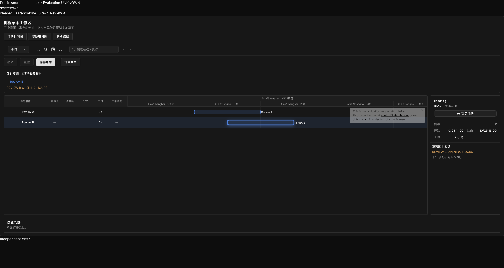
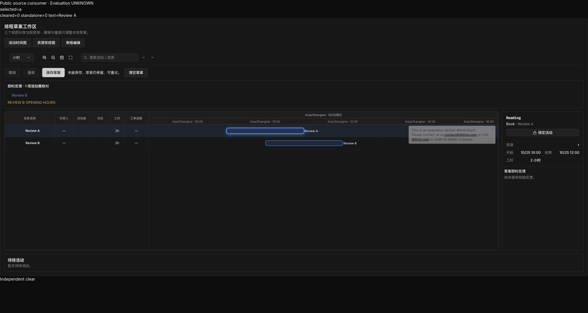
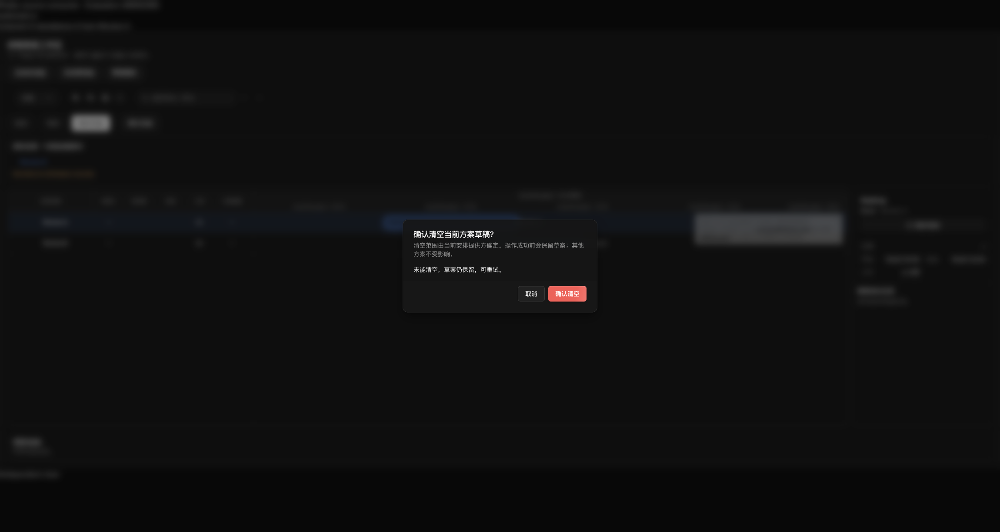

# PR108 R2 两项 P2 返修候选

仅 #92/P09：R1 M1/F1 的 R2 未闭合分支，scope:M、单既有 draft PR108。起点 `16e26892359d9dea3c81209959a1bb9851f15c2b` / tree `f188f5217120cdad6d20f3248224e39af4fb97e3`；base `d8ca1f5ab26cdbf5572de52bce928a8be01b1f1f` / tree `6855d17bd5c87e331ce5999ccbc5ab589344c912`。最终 head/tree/clean 见本轮 durable handoff。

本轮完整回执：`/Users/mang/nerv-delivery-evidence/nerv-ui/2026-10-26/t07-p09-echo-error-fix/handoff.md`。R2 拒绝的完整 receipt、Standards/Spec、原 probe/scripts/raw/截图保留于同日期 `t07-p09-review-r2/`；R1、原实施和上轮返修只沿 `history-pointers.json` 引用。原件、原断言和历史 FAIL/UNKNOWN 均未覆盖。

## 最窄实施与合同

M1 默认原因按传输/problem 词汇、HTTP 状态与 code/stack/API 路径等诊断语法分类，未审英文词句不能仅因带中文前缀而透传。安全中文领域原因、领域缩写及数字标识继续默认可见；可选 formatter 提供已审定原因，技术串/undefined/throw 仍回退。原始 unknown 仍经 `actionError` 诊断；过期操作不 format/report。strict true、false/throw/missing、pending/独立快照/abort/current-controller、同 dialog retry 保持。

F1 Board loading 期间不发送选择命令，ready 边沿只读取最新权威再同步。唯一兼容接缝是 GanttChart/ResourceSchedulerBoard 只读透传既有 Canvas `engineName`；原 props/emits/command 签名、排队规则、engine/loader/useEngine/Canvas 生命周期均不改。它服务 P09 组合协调，没有新引擎协议或 P04/P06/P07 owner。没有固定 timeout、陈旧 ID 黑名单或每次清空重建图；ready 后同步回声由原同步标记隔离，真实后续选择仍可请求。空 ID 继续用原 command 与 model 顶层 envelope 清原生高亮，同实例保留、输入不突变。

合同：[草案可视编辑](../../../scheduling-draft.md)；兼容状态说明位于两个图组件的现有 DESIGN 文档。F2 分组与 F3 摘要原 producer 不变，针对性回归继续通过。没有业务算法、P05/P08、MES/APS 持久化或 `useWorkingScheduleDraft` 增量。

## Requirement | Evidence

正式测试通过主桶操作 props/events/DOM。异步测试仅以 vendor DOM stub 和可释放的 loader 初始化屏障制造时序，执行真实 useEngine 队列与 DhtmlxEngine 命令回声，不是 command spy；它与真实 vendor browser 分列。

| Requirement                                                | Evidence                                                                                                                                                                                                                                                                                                                                                                                                                                                                                                                                                 |
| ---------------------------------------------------------- | -------------------------------------------------------------------------------------------------------------------------------------------------------------------------------------------------------------------------------------------------------------------------------------------------------------------------------------------------------------------------------------------------------------------------------------------------------------------------------------------------------------------------------------------------------- |
| 三处混合 HTTP title 不上屏、原错身份与 true 重试           | `draft action classifies HTTP problem titles mixed with Chinese and preserves diagnostics and retry for save`、对应 `board-clear`、`standalone-clear`。`m1-red.json` 3 FAIL → 最终 3 PASS；原对象 `toBe`，clear 失败仍开、无 cleared，重试 true 才成功。真实 `green-original-core.json` 三处相同输入 `保存失败：503 Service Unavailable`，可见提示为“未能保存/清空，草案仍保留，可重试。”；原文仅诊断。                                                                                                                                                  |
| 有限 HTTP/problem、诊断语法与安全领域边界                  | `draft action classifies unreviewed technical reasons for 'bad-request'`、`'authorization'`、`'not-found'`、`'conflict'`、`'unprocessable'`、`'rate-limit'`、`'timeout'`、`'code'`、`'stack'`、`'endpoint'`；`draft action preserves a safe actionable reason for 'domain'`、`'identifier'`、`'numeric-room'`。追加边界 RED 3 FAIL（code、endpoint 漏出及数字房间误拦）→ 最终 13 PASS。`draft action does not treat unreviewed English words as a domain identifier for 'single-word-title'` / `'compact-problem-title'`，另 RED 2 FAIL → GREEN 2 PASS。 |
| 可选 formatter、undefined 异常与 stale 隔离不退            | `draft action keeps an optional vetted formatter and falls back for an undefined throw`；原 `draft action preserves actionable reasons and isolates formatter failures for save` / `clear`、`draft save does not format or report a late error after authority replacement` 均最终 PASS。原三入口技术 JSON/operationId 回归与 strict callback/pending/snapshot/late 回归亦 fresh PASS。                                                                                                                                                                  |
| 加载期最新权威、多旧选择、空/未知/同 ID 当前对象、资源重挂 | `draft waits for initialization before synchronizing current selection for latest`、`many`、`empty`、`unknown`、`same-id`、`resource-remount`。`f1-red.json` 六条出现真实队列回声行为 FAIL（同报告另含 M1 三 FAIL）；最终六 PASS。每条还断言随后 readonly 用户点击能采用、无额外请求、单活实例、原 model 字节不变。                                                                                                                                                                                                                                      |
| 卸载晚回不请求                                             | `draft discards loading selection when unmounted without emitting a late request`：RED 阶段已有的通过对照，最终继续 PASS；释放全部旧/新初始化屏障，无固定等待。                                                                                                                                                                                                                                                                                                                                                                                          |
| 真实延迟 vendor 初始化不回退                               | 原 R2 probe 结构与外部 HTTP JS/CSS 各延迟 1500ms。fresh RED：mounted A 34.9ms → B 186ms → 无点击 request A 1591.2ms，最终 A。最终 GREEN：mounted A 116.8ms → B 267.9ms，vendor responseEnd 见 `green-original-core.json`，请求空、host/详情/原生高亮均 B；随后真实 A 点击接受。原 probe/raw 不改；本轮 `red-original-f1.json` 与 `green-original-core.json` 分列。                                                                                                                                                                                       |
| 同步拒绝/接受/空/删除/readonly/三视图、原生点击目标        | 原 `draft selection requests changes once and keeps current authority across rejection replacement deletion and readonly` 最终 PASS；真实 `browser-f1-green.json`。`empty rejection followed by accepted bar selection retains native click target` 三轮均 PASS，mousedown/up/click 同目标且 downConnected，不以 remount 修空选择。                                                                                                                                                                                                                      |
| F2/F3、三视图编辑及保存清空保留                            | 原分组/feedback summary 正式用例最终 PASS；真实 `browser-f2-green.json` / `browser-f3-green.json` 保实际 select、两图发现/替换/当前 identity、unknown/empty/missing。`browser-order-table-delivery.json`、`browser-resource-delivery.json`、`browser-saveclear-delivery.json`、`browser-studio-delivery.json`：order/resource 接受拒绝、表格资源/时间、锁/待排恢复/undo/redo、外部 plan/readonly、两个领域/旧入口往返；保存独立副本；清空 **14:00→失败仍14:00→同 dialog 重试成功13:00**。                                                                |

## Fresh 验证与边界

- 最终 scheduling **291 discovery /287 PASS /0 FAIL /4 原 stub skip**；public 文件49 PASS、异步选择文件7 PASS。host **310 PASS**；docs-source **6 PASS**。原四 skip 执行0，非 real-vendor conformance；未增 skip/exclude/timeout。focused 未选条目不冒 suite skip。JSON 缺 unhandled/errors/runtime 字段仍 null。
- 四包 types、public Consumer.vue types、root/nested/probe build、受影响 fmt/lint 最终通过；命令、cwd、起止和 exit 见 `raw/gates.jsonl`。本轮类型准备失败、CLI 路径错误、T3 两次 snapshot timeout 全保留。重型门禁与浏览器串行。
- actual root/nested/probe HTTP URL/status/MIME/bytes/SHA/body 与各自 fresh dist 比对；精确观测数量见 `raw/http-root.json`、`http-nested.json`、`http-probe.json`，包含真实加载的 runtime chunk，不以旧 copy proof 或预设数字代替。原生80%/125% zoom 未跑，不用 DPR 冒证。
- 完整 lock bytes/YAML 全对象973 packages/973 snapshots、metadata/optional/peer/importer/actual edge 不变；四包 actual Vue3.5.39 同模块/同 ref。三 vendor 891743/142723/211538 bytes 与 base 同 SHA，版权/Evaluation/水印与本地字体/license/transform 不改，商业授权 UNKNOWN。
- engine/command/loader/useEngine/Canvas、P03 composables、P05 projection、P08 model/legend/scale、theme/migration 逐字不变。main RAW diff-check2 历史单列，不清 raw；ticket/repair/maintenance 分别核验。

## 历史、UNRUN 与清理

R1/R2 拒绝、初版 remount 导致原生 click target detach 的 RED、旧 order-drag timeout/0 proposal 根因 UNKNOWN，以及原 initial-log 覆盖后仅摘录残存事实的 provenance 均沿历史指针保留。当前 PASS 不消除这些历史。

本轮初始错误包括 scratch 无 vite binary（改实际 vp）、新测试类型声明、scratch 类型解析链接、字体 license 的包路径；均已纠正，失败保留。最终 runner 复用名称时保留失败日志副本和先前行；最后成功不改原失败 exit。本轮 RED 时未额外封存 HTTP body，RED 运行事实来自本轮 trace/截图；历史 R2 原 body 仍在原目录，最终 body 只认证本轮最终 dist。

UNRUN：CI、完整 docs10、packed11、device、旧 consumer13/15、父8组合、真实 SDK/APS-save backend、生产发布/商业授权核验、原生 zoom 80%/125%、独立 R3及完整旧 UI/mobile/native503/theme/尺寸/双实例矩阵。callback 均中性本地 fixture。未逐字审全 vendor/d.ts、其它 app、全部历史 raw/controller 正文或重验全部471项；完整 R2 receipt/双轴、脚本、核心 raw、reporter 结果与截图已定向核对，body 只作字节证据。P01/P02/P03字号/ETA/#43/#51/P10–16 不搭车。

真实 `.nerv-tip/.nerv-drop-hint/.nerv-drop-cancel` 先观察非零，再卸载归零；清理计数及 TZ/scale 见 `browser-cleanup-final.json`。仅清本席 PID、tabs/Space 和 scratch symlink，不删工作树。保持 PR108 draft、#92/#8/#1 open、PR18 draft；仅提交候选，由父安排独立 R3，未 ready/merge/close/watch/发布。
