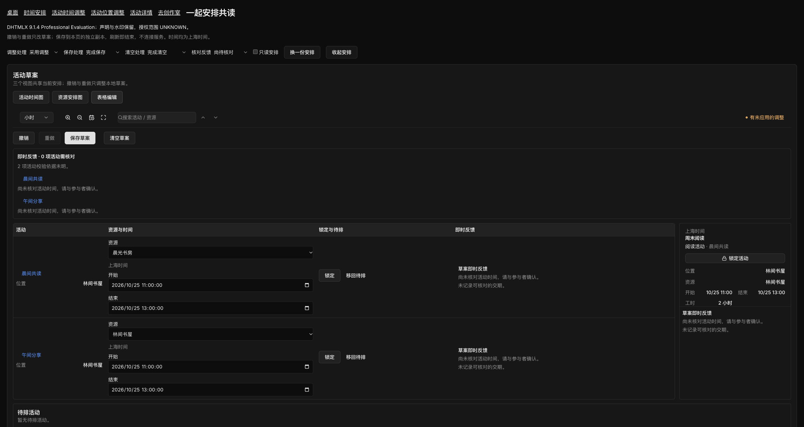

# PR108 R3 F4/P2 · 中性 host 空间映射返修候选

仅 #92/P09、scope:M、单一 host recipe owner、既有 draft PR108。起点 `075a7ccd57223061e59822d6f8bf799de2f33631` / tree `86c3c46d84d4ce39bc9ca6e33c5ab5ca15cd7cd7`；base `d8ca1f5ab26cdbf5572de52bce928a8be01b1f1f` / tree `6855d17bd5c87e331ce5999ccbc5ab589344c912`。最终 head/tree/clean、逐项 blob/SHA 与原始输出见 durable `/Users/mang/nerv-delivery-evidence/nerv-ui/2026-10-26/t07-p09-room-mapping-fix/handoff.md`。本席只交实施候选，独立 R4 由父安排；未独立审核、ready、merge、close、watch、启动后继或发布。

## F4 与最窄修复

R3 原始 `review-receipt.md`、`spec.md`、`standards.md`、`raw/material-f4-resource.json`、`scripts/browser-03-resource-material.mjs` 与两张截图留在同日期 `t07-p09-review-r3/`，未覆盖。其真实鼠标反例：晨间共读从晨光书房拖到林间书屋，时间真实变为11–13，详情/当前安排林间，表格仍选 `room-0` 晨光。

P07 维度改派有意携带 source resourceId；库不推断设备身份。当前两领域 recipe 的空间与资源目录显式一对一，修复仅在 `DraftEditingDemo.vue`：空间 assignment 按**当前** `model.resources[].dimensions.workCenter.id` 反查 room；表格选择资源反向映射空间；空间 null 清 room/空间，team/其它维度的 id/null 保留原独立资源与空间。维度事件携带的 source resourceId 不再被误当作新资源选择。所有输出继续读同一个 host 快照，接受/拒绝、保存副本与 undo 各保原义。公共 payload、P07 算法、原默认值/events/assignment null 语义均不改。完整合同见 [草案合同](../../../scheduling-draft.md)。

## Requirement | Evidence

正式用例在 `frontend/apps/playground/src/DraftEditingDemo.test.ts`，通过公开组件 props/events 与 DOM 验证实际 authority，不只检查 event spy。四条新增测试全部在最终 `raw/host-final.json` passed；jsdom lane 与真实 vendor 分列。

| Requirement                                                                                                                 | Evidence                                                                                                                                                                                                                                                                                                                                                                                                                                                                                                                                                                                                                                                                                |
| --------------------------------------------------------------------------------------------------------------------------- | --------------------------------------------------------------------------------------------------------------------------------------------------------------------------------------------------------------------------------------------------------------------------------------------------------------------------------------------------------------------------------------------------------------------------------------------------------------------------------------------------------------------------------------------------------------------------------------------------------------------------------------------------------------------------------------- |
| 空间采用后三视图、详情、当前 resourceId、真实时间/记录一致；拒绝不变；保存副本与 undo/redo                                  | `neutral library host maps accepted space assignment to the current room across table detail graphs saved copy and undo`；`neutral studio host maps accepted space assignment to the current room across table detail graphs saved copy and undo`。本轮 `f4-red.json` 两个行为 FAIL（room-0≠room-1）→`f4-green.json` 两 PASS；最终全套继续 PASS。                                                                                                                                                                                                                                                                                                                                       |
| 非空间 team/id/null、其它维度 id/null 保独立资源；空间 null 与表格 resource 清空、反向映射、换 plan 后当前目录、两图与 undo | `neutral library host keeps non-space assignments independent and maps space clear table resource and replacement in both directions`；对应完整名称 `neutral studio host keeps non-space assignments independent and maps space clear table resource and replacement in both directions`。最终均 PASS。                                                                                                                                                                                                                                                                                                                                                                                 |
| actual app + 独立 source consumer、两领域真实鼠标跨空间                                                                     | `browser-f4-green-app-library.json`、`browser-f4-green-app-studio.json`、`browser-f4-green-probe-library.json`、`browser-f4-green-probe-studio.json`：同样鼠标12步从空间0拖到1；表格实际 option.value=room-1，选项文本/详情/当前安排相符，两图实际 aria 投影均资源room-1，11–13与记录一致。probe 直接消费当前 recipe 和公共库，不替换 engine、不调用私有 callback；source lane，不冒 packed。                                                                                                                                                                                                                                                                                           |
| 拒绝、team独立、空间null、表格反向/清空、保存副本/undo、换plan、clear retry                                                 | `browser-boundaries-library.json` / `browser-boundaries-studio.json` 各19个持久观测。拒绝仍room-0；采用room-1；保存后undo回room-0而副本仍room-1；redo回room-1；表格改room-2；真实team改派后仍room-2；拖到未分配泳道后表格空；undo回room-2；表格空；换plan重置room-0，再真实拖动至room-1。清空 **14:00/room-1→失败仍14:00/room-1→同dialog重试成功13:00/room-0**。team null/其它维度边界由上述正式用例证明，不冒这两项也实跑了鼠标。                                                                                                                                                                                                                                                      |
| 原行为不回退                                                                                                                | 原 host6 条全部 fresh：`neutral draft host accepts and rejects table edits then visibly undoes and redoes without saving`、两个 `neutral library/studio draft shares resource lock pending restore and undo across table detail and both public boards`、`neutral save stores a separate copy while local undo and external plan replacement retain their own meaning`、`neutral host applies public drag assignment and null membership without changing resource identity then rejects a later proposal`、`neutral clear failure keeps the same dialog open and a successful retry resets local draft only`。M1/F1/F2/F3 的库 producer 与测试逐字未变，只有限继承 R3 对原反例的闭合。 |

当前三视图实际数据（app 与 probe 相同）：

| 领域/活动        | resource图 / order图实际投影 | 表格实际value /文本 | 详情位置与当前安排 | 时间                       |
| ---------------- | ---------------------------- | ------------------- | ------------------ | -------------------------- |
| library 晨间共读 | resource room-1，林间书屋    | room-1 / 林间书屋   | 林间书屋           | 上海2026-10-25 11:00–13:00 |
| studio 晨间创作  | resource room-1，陶艺工坊    | room-1 / 陶艺工坊   | 陶艺工坊           | 上海2026-10-25 11:00–13:00 |

## Fresh、有限继承与历史限制

- **Fresh：**host **314 PASS/0 FAIL/0 skip**（原310+新增4；P09文件10）；docs-source **6 PASS**；四包 types、root/nested build、独立 probe Consumer.vue types/build、受影响 fmt/lint 最终 exit0。命令、明确 cwd、起止与退出码见 durable `raw/gates.jsonl`。reporter 缺 unhandled/errors/runtime 字段仍 null，不补0；原 jsdom CSS、第三方 annotation/chunk-size 提示保留。未增 skip/exclude/timeout。
- **有限继承：**R3 scheduling **291 discovery/287 PASS/4原stub skip**，四skip执行0、非real-vendor conformance。本轮只改recipe，库engine/loader/useEngine/Canvas/command/P03/P05/P08/factory-time、M1/F1/F2/F3 producer及测试逐字相同；不机械重跑无变化大矩阵，不冒本席fresh scheduling或全browser矩阵。公共Consumer类型合同未改，旧公开消费证据仅按同producer继承；当前probe自身types为fresh。
- **产物：**本轮实际HTTP root7/nested7/probe6，加RED产物7；URL/status200/MIME/bytes/SHA/body各与各自fresh dist相等，含实际runtime chunk。RED产物是本轮从旧head源码fresh构建后保存的scratch产物，HTTP回读在后续收尾进行，不冒R3或旧作者的原HTTPbody。
- **身份/边界：**lock完整bytes/YAML973 packages/973 snapshots及全metadata/optional/peer/importer/actual edges相同；四包实际Vue3.5.39同模块/同ref。三个vendor891743/142723/211538 bytes、版权/Evaluation/水印、字体/license与transform不改，商业授权UNKNOWN。main RAW diff-check2历史分列，ticket/repair/maintenance/staged0，不删raw修绿。
- **本轮FAIL：**原head正式两条RED与真实鼠标room-0≠room-1断言失败保留；边界测试初次因换plan改名后仍找旧aria-label失败，改用稳定task ID后通过；probe types初次scratch缺@types/node，补本席解析链接后通过。T3 about:blank参数拒绝后纠正为HTTP，snapshot同一步两次原始 `Preview automation snapshot timed out after 15000ms.` 后按ego技能切换；Ego提示更新，未升级。
- **历史限制：**原implementation-r1/contract-fix/echo-error-fix中“三视图资源同步PASS”不能覆盖F4。尤其 `echo-error-fix/raw/browser-resource-delivery.json` 详情林间而表格room-2，脚本当时错误接受了这个矛盾；本轮不继承其完整资源AC证明、不改原raw、不倒填旧PASS。本轮另有独立RED与GREEN。所有R1/R2/R3拒绝、其它RED/FAIL/UNKNOWN、order-drag timeout/0 proposal根因UNKNOWN、remount nativeclick RED、初始log覆盖后仅摘录的限制保留。
- **清理：**本轮真实resource模式先写before counts，再断言真实 `.nerv-tip/.nerv-drop-hint/.nerv-drop-cancel` 各1；卸载后engine/bar/三者全0。Asia/Shanghai与scale1回读，viewport override已撤。原R3清理前提FAIL与after UNRUN仍成立，不以本轮成功或整体关页改写它。Ego Space94 finish keep=[]恰一次，T3自有tab关闭。仅清自己经command/cwd核对的PID与scratch链接，不删tree。

未决实施异议：本席未发现仍未处理的F4映射缺口；这不是独立接受结论，父另安排R4。未逐字审全vendor/d.ts、全部历史raw/controller、其它app或未改全仓；旧材料为定向阅读，不冒全部历史归档认证。P01提示/P02年/P03字号/ETA/#43/#51/P10–16不搭车；不迁MES/APS backend/useWorkingScheduleDraft/业务资格。

UNRUN：fresh install、CI、完整docs10、packed11、device、旧consumer13/15、父8组合、真实SDK/APS-save backend、生产发布/商业授权核验、原生80%/125%zoom、独立R4和更宽未改UI/mobile/native503/theme/尺寸/双实例browser矩阵。只运行了本页列出的真实consumer与两领域必要路径，callback均为中性本地fixture。#92/#8/#1保持OPEN，PR108/PR18保持draft，watching=false。
